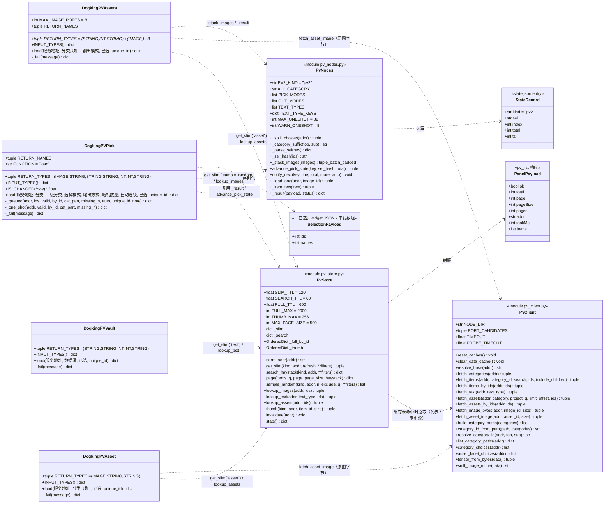
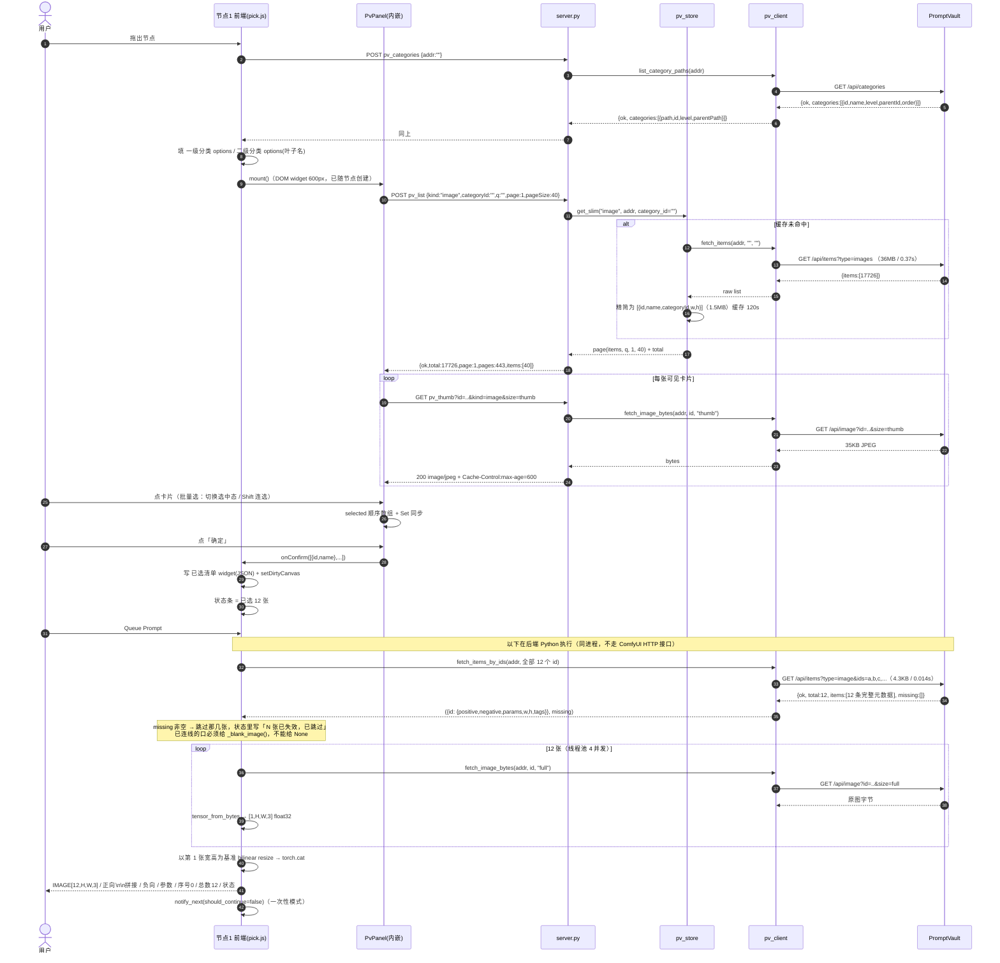
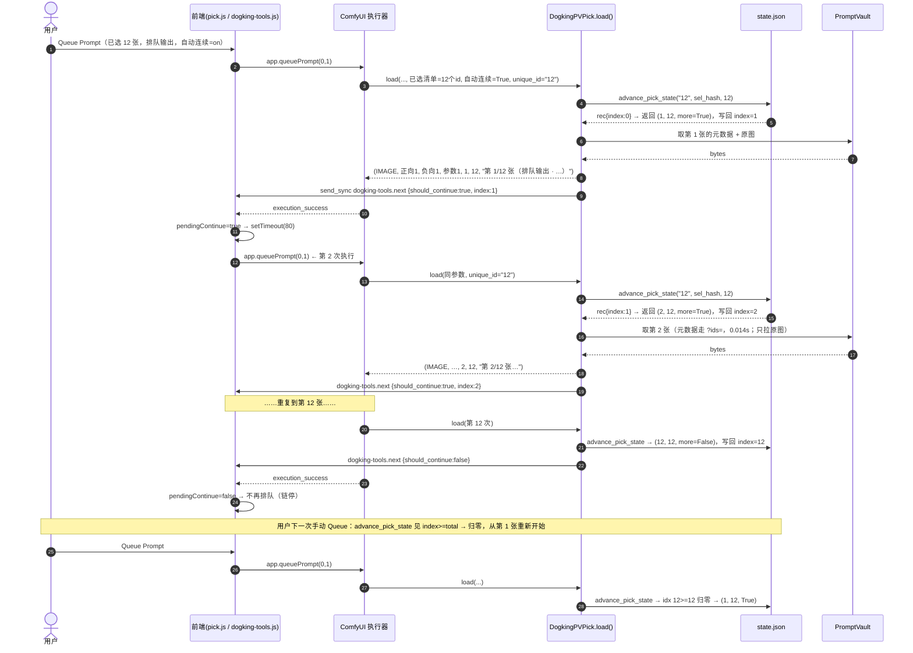
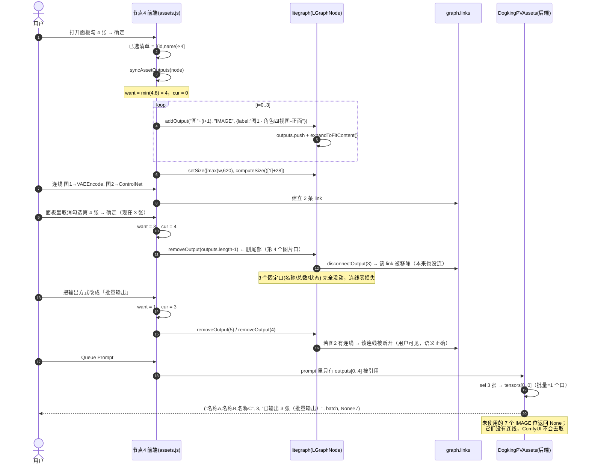
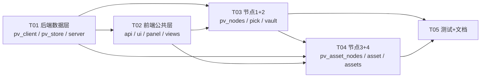

# ARCH：dogking-tools 节点 v2（PromptVault 可视化选择）

- **Language**：中文
- **Programming Language**：Python 3.10+（ComfyUI 后端）+ 原生 ES Module JS（ComfyUI 前端扩展，无框架）
- **依据**：`docs/PRD-comfyui-nodes-v2.md`（v2 PRD，519 行）+ 用户已拍板的 3 条决策
- **目标 ComfyUI**：`0.45.0` / `comfyui-frontend-package 1.58.5`（实测于 `H:\ComfyUI_windows_portable`）

---

## 0. 用户已拍板的决策（覆盖 PRD）

| # | 决策 | 对 PRD 的改动 |
|---|---|---|
| D1 | **硬删**旧 4 个 PV 节点，不留旧版兼容 | PRD Q6 选 A，一致 |
| D2 | 节点 4 **动态输出口**：每张选中图一个独立 IMAGE 口，上限 8 | PRD 3.4.3 方案 A，一致 |
| D3 | **内嵌式面板**：面板长在节点内部，节点被撑大（接受 600px 高） | **PRD 第 3 章「弹窗 overlay / fixed 1080×680 / Esc 关闭 / 点遮罩关闭 / 单例面板」全部作废** |

D3 的连带改动（本文档已按此设计）：

- 面板不再是全局单例，**每个节点一个**；不存在「已有面板时聚焦已有面板」的逻辑。
- 不存在 `Esc` 关闭 / 点遮罩关闭；改为**节点上的「收起面板 / 展开面板」按钮**（收起后节点回到 ~200px 高）。
- 面板内部交互继续沿用 PRD：网格/卡片布局、分页、三种选择模式、选中态、Shift 连选、跨页保留、缩略图走后端代理。
- 面板工具条里的「分类下拉」**去掉**：一级/二级下拉就是节点上的 COMBO，面板紧贴其下，重复一份只会造成两处状态不同步。工具条改为「当前筛选文字 + 搜索框 + 共 N 张 + ↻刷新」。

---

## 0.5 接口实测事实（**优先于 PRD 第 1.3 节**）

> 测于 PromptVault 1.3.10 运行态（`127.0.0.1:8765`）。**分两批**：
> 第一批是我自己打桥服务测的；第二批是工程师补测的全库统计 + 进程 RSS（我原来估错的地方，以他实测为准）。

| 实测项 | 数据 | 结论 |
|---|---|---|
| `GET /api/items?type=images`（全量） | **34.4MB / 0.32s / 17726 条** | 与 PRD 一致，绝不能进浏览器 |
| 单条 item 平均 | **1643 B**（最大 12976 B） | 长文本占大头，这就是不能长驻 `_raw` 的原因 |
| 精简 5 字段（id/name/categoryId/w/h） | **1.82MB**（工程师全库实测） | 可长驻，按分类多份也无所谓 |
| `GET /api/items?type=image&ids=a,b,c` | **4.3KB / 0.014s** | **体积缩小 8000×、耗时缩小 23×** |
| `GET /api/assets`（全量） | ~30KB / 0.014s / 78 条 | 全量拉即可，不需要分页 |
| `GET /api/assets?ids=a,b,c` | 620B / 0.014s | 同上 |
| `?ids=` 返回顺序 | **= 传入顺序**（实测打乱 3 个 id，回的顺序与传入一致） | 已选清单的顺序能原样还原 |
| `?ids=` 的 `missing` | 传 `no-such-id-xxxx` → `missing:["no-such-id-xxxx"]`，**HTTP 200** | 失效 id 可直接透传，不用 404 分支 |
| `?ids=` 去重 | 5 个 id（含 1 个重复）→ `total:3` | 前端不用自己去重 |
| `?ids=` 是否忽略残留筛选 | 带 `&category=NOPE&search=zzzz&limit=1&offset=99` 仍返回该条 | 不会被残留条件悄悄吃掉 |
| `?ids=`（空串） | `200 {"ok":true,"total":0,"items":[],"missing":[]}` | 空清单可直接请求，不用特判 |
| image item 字段 | `id,name,positive,negative,params,tags,categoryId,width,height,createdAt` | 字段都在，但 `tags` **全库非空 = 0 条**、`negative` **全库全空** |
| asset item 字段 | `id,name,category,project,**note**,width,height,size,mime,createdAt` | `note` 已加，但**78 条全是空串** |
| `categoryId` 的粒度 | 17726 条里**只有 4 个取值** = 3 个一级 id + `null`（295 条） | 二级 id **不暴露**（`"subCategoryId" in item` = False），见硬结论 1 |
| **`positive` 全库体积** | **31.34 MB** UTF-8 / **≈22.72 MB** Python 驻留 | ⚠️ **我原估"+10MB"偏了 3 倍**，见 §2.3 |
| `name` / `params` / `negative` 体积 | 0.12MB / 0.01MB / **0.00MB** | `negative` 全库全空，搜它没意义 |
| `tags` 全库 | **非空 0 / 17726，不同 tag 数 0** | 不搜也不留 |
| 进程 RSS（基线→列表→搜索） | 1513.8 → 1551.3 → 1583.0 MB | 搜索索引真实代价 ≈ **+32MB RSS** |
| 搜索耗时 | 索引命中 **18ms** / 重建 **82–499ms** / 换分类后首搜 **309ms** | — |
| **`pv_list` 与 `pv_random` 口径一致性** | 6 种筛选组合 × 每种抽 200 个：`total` 六项全等，**「抽到但不在列表里」= 0** | ✅ 两条路径物理共用 `_filter_items()`，不存在漂移，见硬结论 3 |
| `_full_by_id` TTL 边界 | t=599s 命中 / t=601s 过期重取 / 过期后条目数 = 0 | 过期在**取的时候当场 `del`**，不留垃圾条目 |

### ✅ 硬结论 1：二级分类筛选语义**正确**，但一级分类必须带 `includeChildren=1`

工程师用「分区精确相等」证明了服务端二级筛选是真的按二级 id 匹配：

```
一级「风格」+includeChildren = 12042
   写实摄影 9328 + 动漫 1249 + 油画 255 + 水彩 70
 + 3D渲染 734 + 像素 9 + 赛博朋克 260 + 水墨 137  = 12042   ← 精确相等
一级「主体」+includeChildren = 4003
   女性 1784 + 男性 65 + 建筑 701 + 地景 1013 + 物品道具 327 + 机械载具 113 = 4003  ← 精确相等
一级「场景」+includeChildren = 1386
   室内 341 + 街道 585 + 自然荒野 29 + 幻想世界 248 + 太空 172 + 水下 11 = 1386     ← 精确相等
全库校验：12042 + 4003 + 1386 + 295(无分类) = 17726   ← 一张不漏、一张不重
```

**为什么这能证明语义正确**：如果二级筛选实际按一级 `categoryId` 匹配，20 个二级会各自返回整个父分类的数量（都等于 12042）；如果匹配不上会全是 0。现在「每个子分类拿到自己那份，且子分类之和精确等于父分类」——底层确实按 `subCategoryId` 精确匹配。

根因也确认了：**不是数据里没有二级信息，而是桥服务不暴露它** —— `toItemMeta` 只映射了 `categoryId`，`subCategoryId` 在渲染层内部有、但没进 item 字段。

**所以两条结论：**
1. **禁止**做"拉一次全量 → 在内存里按 `categoryId` 筛二级"。永远只能筛到一级粒度。
2. 🔴 **一级分类必须带 `includeChildren=1`，不带返回 0 条**（不是"少一点"）。因为这个库里**每一张图都挂在二级分类下，一级分类自己不直接挂图**。对二级是无害 no-op（带不带都 9328）。
   ⇒ `fetch_items` 必须保持「**只要传了 category 就默认带**」。**这是最容易被重构静默打破的一条，必须有回归测试。**

**🔎 这个 bug 的排查特征（用户报障时 10 秒定位）**

> **选一级分类 → 0 条；选二级分类 → 正常。**

只要看到这个组合，就是 `includeChildren` 丢了，不用查数据、不用查网络。已由 `tests/test_pv_client.py` 第 1 组 4 条断言守住，失败信息也按这个特征写。

### ⚠️ 硬结论 2：`pv_meta` 从 P0 降为 P2 预留（不是删除）

原设计里"按 id 取元数据"要靠"拉全量 + 内存建 id 索引"，代价 34.4MB / 0.32s / 峰值 50MB。现在 `?ids=` 是 **4.3KB / 0.014s**，所以：

- **节点执行阶段**：节点和后端在**同一个 Python 进程**里，直接调 `pv_client.fetch_items_by_ids()`，**根本不需要经过 ComfyUI 的 HTTP 接口**。
- **前端阶段**：已选清单的 `ids` + `names` 已序列化在「已选」隐藏 widget 里（§4.3），缩略图走 `pv_thumb?id=`。P0 主流程**不需要**它。

**处置**：工程师已把它实现成 `pv_store.lookup_*` 的 3 行薄封装且实测通过，删掉反而是额外工作。所以 **保留但降级**，并定下**允许调用的完整清单**（避免"禁令太宽导致实现看着违规"）：

| 场景 | 允许？ | 说明 |
|---|---|---|
| `onConfigure` / `onNodeCreated` 恢复选中 | 🔴 **禁止调 `pv_meta`** | 每次打开工作流给每个 PV 节点发一次请求（4 节点 = 4 请求），纯浪费 |
| 面板 `setSelection()`（内部状态恢复） | ✅ 不涉及 | 实测**零网络**，只改内部状态 + class + footer 文字 |
| 用户点「随机抽 N 张」后把裸 id 补成卡片 | ✅ **允许** | 用户显式点击触发的**一次性批量**调用（一次传全部 id），不在 `onConfigure` 路径上 |
| P2「校验已选清单」按钮 | ✅ 允许 | 用户显式点一下 |
| **`onConfigure` 里补 1 次 `pv_categories`（≤2KB）** | ✅ **允许，且必要** | 见下方「R20 的真正成因」 |

> 判据不是"哪个阶段"，而是「**是不是用户显式动作触发的、且每次动作只调一次**」。
>
> **唯一的例外**是上表最后一行：`onConfigure` 补分类列表属于"修正首载参数"。
>
> 🔒 **这个豁免为什么成立（不要拿它当口子）**：
> 不补的代价是**按「全部」加载 34.4MB 且面板显示错误内容**；补的代价是**一次 2KB 的 `pv_categories`**。两者差**三个数量级**。
> 这不是"因为方便所以豁免"，而是"用 2KB 换掉 34MB + 一个用户可见的错误"。
> **以后任何想在 `onConfigure` 加请求的改动，都必须先回答：不发的代价是不是比 2KB 大三个数量级？** 回答不了就不许加。

#### R20 的真正成因：不是"callback 会不会触发"，是"面板首载早于 configure"

这个坑我一开始判断错了方向，值得单独记下来，因为**判断错方向会导致修错地方**：

| 我当时的假设 | 实测结论 |
|---|---|
| 如果 `configure` 不触发 widget callback → `__dkCats` 一直空 → 分类筛选失效 | `configure` **会**触发 callback（实测 `catFiredDuringConfigure: true`），`pv_categories` 也确实发了 1 次 |
| 所以修法是"确保 callback 被触发" | ❌ **错**。callback 触发了、`__dkCats` 也填上了，**问题依然存在** |

**真正的时间线**：

```
onNodeCreated  →  createPanelHost → rebuild() → PvPanel 构造 → _load(1)
                   ↑ 此刻 __dkCats 一定是空的（还没拉过分类）
                   ↑ categoryId 传空串 → 按「全部」加载 34.4MB
onConfigure    →  widget 值恢复 → callback 触发 → __dkCats 被填上
                   ↑ 但**没有任何东西通知面板"筛选条件变了"**
                   ↑ 面板停留在「全部」，而节点上写着「风格/写实摄影」
```

⇒ **结论：光靠 callback 填 `__dkCats` 永远不够，必须显式触发面板重载。** 正确修法三步：

1. `cancelPending()` 取消 `onNodeCreated` 排的延迟建面板（`panel-host.js` 用 `setTimeout(...,0)` 延后建，就是为了给 configure 一个取消窗口）
2. 分类非「全部」且 `__dkCats` 为空 → `await refreshSubCategories()`（带 `!__dkCats` 判断，callback 已填过就跳过 → 最终只 1 次 `pv_categories`）
3. 面板若已存在 → `applyFilters()` 用正确筛选重载

**推广**：这条已提升为 **§0.5 硬结论 4「状态变化 ≠ UI 重载」**，那里有完整的三条落地要求和同类风险清单。本节只保留 P0-2 这个实例的成因分析。

`_raw`（完整 dict 列表）**确实删除** —— 它被 `_search` 索引取代，见 §2.3。
`_full_by_id`（LRU 2000 ≈ 2MB）**保留** —— 它挡的是"一轮批量执行里同一批 id 被反复取"（12 张图跑 12 次队列 = 12 次 HTTP vs 1 次），2MB 换掉重复请求划算。**必须带 TTL 600s，且过期条目要在读取时当场 `del`**（不能只判过期不删，否则 `stats()` 的条目数会虚高）。

### ✅ 硬结论 3：`pv_list` 与 `pv_random` 的筛选口径**物理上是同一份代码**

这是我在评审时提出的隐患：如果列表用搜索索引筛、随机用原始字段筛，会出现"列表里有 40 条匹配，点随机抽 4 张，抽出来的在列表里找不到"。

工程师的实现把筛选收在唯一一处：

```
pv_list   → search_haystack() → page()          → _filter_items()
pv_random → search_haystack() → sample_random() → _filter_items()
```

`_filter_items(items, q, haystack)` 是**唯一**的过滤实现，`page()` 和 `sample_random()` 都只是调用方。**没有第二份实现，所以不存在漂移的可能** —— 这比"两处代码写一致"可靠得多。

端到端实测（6 种筛选组合，每种抽 200 个，远超单页 40 张，能同时暴露"只在当前页抽"和"口径不一致"两类问题）：

```
无筛选          列表=17726  随机total=17726  抽到=200  不在列表里=0
q=黑胶唱片       列表=28     随机total=28     抽到=28   不在列表里=0
q=少女          列表=1481   随机total=1481   抽到=200  不在列表里=0
一级分类 风格     列表=12042  随机total=12042  抽到=200  不在列表里=0
二级分类 写实摄影   列表=9328   随机total=9328   抽到=200  不在列表里=0
分类+搜索        列表=936    随机total=936    抽到=200  不在列表里=0
```

**维护约束**：以后任何新增的筛选维度（排序、标签、创建时间…）都必须加在 `_filter_items` 里，**不许在 `page()` 或 `sample_random()` 里各写一遍**。

### ✅ 硬结论 4：状态变化 ≠ UI 重载 ——「状态就绪时，谁通知 UI 重载？」

> 这条是 T03 评审从 P0-2 那个 bug 里提炼出来的，**适用于本插件所有前端改动**，所以放在硬结论区而不是只写在 R20 的成因里。

**一句话**：**callback 负责"填状态"，不负责"通知 UI 重载"。这两件事极容易被合并成一件来想，然后漏掉后一半。**

#### 🔎 先看判据：不是所有"依赖异步数据的下拉"都有这个坑

> 这条是 T04 实测后**收窄**的。我最初写成"节点 3/4 的项目下拉会遇到和 P0-2 一模一样的时序问题" —— **实测证明不成立**，所以必须给出可判定的边界，否则会让人误判、白做兜底。

**判据：`filters()` 里有没有「用异步拿到的数据去 *换算* widget 值」这一步？**

> 换个更好记的说法：**这个值能不能直接从 widget 读出来就传给后端？**
> **能** → 不受影响（异步数据只影响"下拉里有哪些选项"，不影响"当前值是什么"）；
> **不能**（要查表 / 解析 / 聚合）→ 必须回答"状态就绪时谁通知重载"。

| 情况 | 有无时序坑 | 例子 |
|---|---|---|
| **有换算**（widget 值 → 查异步表 → 得到要发的值） | 🔴 **有** | 图片分类：`「风格/写实摄影」` 需要 `__dkCats` 映射成 `mvz14azd-eke0cs`。表没来 → 解析成空串 → 面板拉全量 |
| **纯透传**（widget 值原样就是能发的值） | ✅ **没有** | 资产分类/项目：`category`/`project` 本身就是字符串名，`filters()` 直接 `cat === ALL ? "" : cat`，不查任何表 |

**为什么纯透传没有坑**：异步数据（facets）只决定「下拉里有哪些**选项**」，不决定「当前**值**是什么」。当前值来自 widget，configure 之后就绪了，与异步结果无关。

实测对照（保存「分类=角色四视图 + 项目=凡人 + 已选 2 张」→ 重开 → 展开）：

```
保存前面板 = 20 条（已筛过，不是 78）
重开后展开 = 20 条（完全一致）
工具条     = 「角色四视图 · 凡人」
configure 期间 0 次 pv_list（1 次 pv_categories）
```

#### P0-2 的完整链路（这个才是真的有坑）

```
onNodeCreated  →  建面板 → _load(1)      ← 此刻 __dkCats 还没拉，路径解析成 "" → 按「全部」加载 34MB
onConfigure    →  widget 值恢复 → callback 触发 → __dkCats 被填上   ← 状态「就绪」了
                →  ❌ 但没有任何东西通知面板"筛选条件变了" → 面板停在「全部」
```

**我当时判断错的方向**（值得记下来，因为会导致修错地方）：

| 假设 | 实测 |
|---|---|
| configure 不触发 widget callback → 数据一直空 → 筛选失效 | configure **会**触发（实测 `catFiredDuringConfigure: true`） |
| 所以修法是"确保 callback 被触发" | ❌ **错**。callback 触发了、数据也填上了，**问题依然存在** |

⇒ **只要 UI 的首次加载早于某个"要参与换算"的状态就绪，就必须显式安排一次重载**，不能指望"状态填好了 UI 自然就对"。

**三条落地要求**：

1. 面板的延迟建面板用 `setTimeout(...,0)`，给 `onConfigure` 一个 `cancelPending()` 的取消窗口（`panel-host.js`）。
2. 任何在 `onConfigure` 里补的状态，补完必须调一次 `applyFilters()` / `setSelection()` 之类的重载入口。
   **即使当前判据显示"没有坑"也要加** —— 它是零成本兜底（收起时是 no-op），且万一以后某个维度从"透传"改成"查表"，通知点已经在位。节点 3/4 就是照这个做的。
3. **新增任何"首载依赖异步状态"的功能时，先回答：状态就绪的那一刻，谁调重载？** 答不出来就说明还缺一个通知点。

**同类风险清单**（以后加功能时对照，**按判据分类**）：

| 维度 | 有坑？ | 说明 |
|---|---|---|
| 图片分类（一级/二级） | 🔴 有 | 路径 → id 需要 `__dkCats` 换算（P0-2 实例） |
| 资产分类 / 项目 | ✅ 无 | 字符串名纯透传（已实测） |
| 面板 `textType`（节点 2 数据源） | ⚠️ 看实现 | 如果 `textType` 只是枚举直传 → 无坑；若要查表映射 → 有坑 |
| 词库卡片的 `chars` 统计 | ✅ 无 | 纯展示，不参与 `filters()` |


---

## 1. 实现方案总览

四个节点全部走同一条数据通路：

```
前端面板（节点内 DOM widget）
   ↓ POST /dogking-tools/pv_list   （只回当前页 40 条精简元数据）
pv_store.py  内存精简缓存  ←  pv_client.py  ←  PromptVault :8765-8775
   ↓ 用户确定 → 已选清单 JSON 写进隐藏 widget（随工作流序列化）
后端节点执行
   ↓ pv_store.lookup_* 按 id 取元数据 → pv_client.fetch_*_bytes 取图 → tensor
输出
```

### 1.1 节点 1：图片 + 提示词（`DogkingPVPick`）

| 参数 | 类型 | 默认 | 显隐 |
|---|---|---|---|
| 服务地址 | STRING | `""`（自动发现 8765–8775） | 常显 |
| 分类（一级） | COMBO（落盘缓存） | `全部` | 常显 |
| 二级分类 | COMBO（叶子名，前端按一级联动收窄） | `全部` | 常显 |
| 选择模式 | COMBO | `单选` | 常显 |
| 随机数量 | INT 1–200 | `4` | 仅「随机多选」 |
| 输出方式 | COMBO | `排队输出` | 仅「批量选 / 随机多选」 |
| 自动连续 | BOOLEAN | `true` | 仅「排队输出」 |
| 已选 | STRING（隐藏，序列化） | `""` | 隐藏 |
| *按钮* | 收起面板 / 重置计数 | — | 收起常显；重置仅排队输出 |

> `随机数量` 保持 1–200（排队输出能跑 200 张）；**只有「一次性全部输出」受 `MAX_ONESHOT=32` 限制**，超出自动降级为排队并告知，见下方「一次性输出硬上限」。

**输出口**（静态 7 个，顺序沿用 PRD）：

| # | 名称 | 类型 |
|---|---|---|
| 0 | 图片 | IMAGE（单张 `[1,H,W,3]`；一次性为 `[N,H,W,3]`） |
| 1 | 正向 | STRING |
| 2 | 负向 | STRING |
| 3 | 参数 | STRING |
| 4 | 当前序号 | INT |
| 5 | 总数 | INT |
| 6 | 状态 | STRING |

**内部流程**

1. `INPUT_TYPES` 不做网络请求（沿用现有 `category_choices()` 的「只读缓存 + 踢后台刷新」策略），保证 `/object_info` 永不阻塞。
2. 执行时把「已选」widget 解析成 `{ids, names}`（`_parse_sel` 兼容三种格式）；`选择模式=随机多选` 且清单为空时，调 `pv_store.sample_random` 现抽（种子可复现留 P2）。
3. `输出方式=一次性全部输出`：**先检查 `len(sel) > MAX_ONESHOT`**（见下）→ `fetch_items_by_ids(ids)`（一次请求拿全部提示词，实测 4.3KB/0.014s）→ 并发下 full 图（线程池 4）→ `tensor_from_bytes` → **尺寸统一（见「尺寸统一策略」）** → `torch.cat(dim=0)` → 提示词按 `\n\n` 拼接、参数按 `\n` 拼接；序号返回 `0`；`8 < N ≤ 32` 时状态里追加「一次输出 N 张，注意显存」。
4. `输出方式=排队输出`：`advance_pick_state()` 推进游标 → 只取第 `index` 张 → `notify_next(should_continue = more and 自动连续)`；跑完 `more=False`，游标自然归零。
5. 任何网络/解码失败：返回 `_blank_image()` + 状态里写原因，**不抛异常**（沿用现有策略，否则批量队列会断）。失效 id 跳过并计数，状态写 `第 3/12 张（2 张已失效，已跳过）`。

#### 🔴 硬规矩：任何"自动改变用户意图"的分支，必须在状态条里说清原因

**这不是某一条逻辑的要求，是所有降级/截断/跳过的通用要求。** 覆盖目前已识别的全部场景：

| 场景 | 必须说的原因 |
|---|---|
| 一次性超 32 张 → 降级排队 | `清单 50 张超过一次性输出上限（32），已自动改为排队输出（本次输出第 1 张）` |
| 词库清单多条 → 只取第 1 条 | `词库仅支持单选，已取第 1 条` |
| 已选 id 失效 → 跳过 | `2 张已失效，已跳过` |
| 图片下载失败 → 灰图占位 | `2 张下载失败，已用灰图占位` |
| 尺寸不一致 → 补边对齐 | ` · 3 张已补边对齐到 1024×1536`（追加在已有状态后面） |

**为什么这条要升级成硬规矩**：这类缺陷的共同特征是「**代码逻辑是对的，用户不知道**」—— 不报错、不崩、单元测试也容易漏，用户只会得出"功能坏了"的结论，然后来报 bug。它比"某个参数别删"更通用，因为**每加一个新功能都可能再犯一次**。

**评审必查**：任何"自动改变用户意图"的分支，先看它有没有对应的状态条文案。

#### 🔴 硬规矩：安全约定必须在**每一条 early return 路径**上执行一遍

这条是从 T04 的 P0 里提炼的 —— **约定写对了，但只在 happy path 上执行了**。

具体案例：`DogkingPVAssets` 的约定是「失效 id 必须返回 `_blank_image()`，`None` 会让下游崩」。代码里：

| 路径 | 是否执行了约定 |
|---|---|
| 逐张取图时某个 id 失效（`:287`） | ✅ 返回灰图 |
| **整体失败时 `_fail`（`:330`）** | ❌ 返回 `None` × 8 → 已连线的下游全崩 |

同一个文件、同一条约定、两条路径，一条对一条错，**隔了 40 行**。而且验收只测了前者，所以"8 条验收全过"。

**规则**：写「任何失败都要返回 X」这类约定时，**写完先 grep 一遍这个函数/类里所有的 `return`，逐个确认它走的是哪条路**。典型的 early return 点：

- 参数为空（`if not ids: return ...`）
- 网络/接口报错（`if err: return ...`）
- 目标不存在（`if item is None: return ...`）
- 兜底 except

**为什么这类 bug 特别难抓**：它只在**错误路径**上复现，而 QA 和单元测试天然偏向测 happy path。P0 这条要"PromptVault 没开 + 已连线"才触发 —— 正常跑一百次都碰不到。

**测试侧要求（T05）**：错误路径要有**独立断言**，不能只测正常流程。至少覆盖：
- PromptVault 关闭状态下 Queue → 已连线的图片口必须收到灰图（`[1,64,64,3]`）而不是 `None`
- 清单全部失效 → 同上

#### 🔴 变异测试表（T05 定稿，含一行必须组合变异才可观测）

「故意改坏一处，测试必须红」——但**每个变异必须指定"应该红的是哪条断言"**，否则只能证明"有东西红了"，不能证明"红的是对的那条"。

| # | 变异 | 应该变红的断言 | 状态 |
|---|---|---|---|
| 1 | `_fail` 里 `_blank_image()` → `None` | PromptVault 关闭时 8 个位都是灰图 | ✅ 已验（3 条红，正好是失败路径那 3 条） |
| 2 | `removeOutput(length-1)` → `removeOutput(3)` | 删第 2 张只断最后一个口的线 | ⚠️ **前端变异，pytest 抓不到**（`tests/` 全是 Python，见下） |
| 3 | `_sel_hash(ids)` → `_sel_hash(valid)` | 删掉清单里一张后游标不归零 | ✅ 有断言守着（`test_pick_queue_cursor_continues_after_middle_deletion`） |
| 4 | 去掉 `did_pad` **或** 改回逐维口径（单改） | 纯等比放大不计入 padded | ⚠️ **单改都是 0 failed（不可观测）**，必须组合变异，见下 |
| 4c | 两处**同时**改坏 | 纯等比放大不计入 padded | ✅ 1 failed（`pure_scale_counts_zero_padding`） |
| 5 | 去掉 `includeChildren=1` | 一级分类不带 → 0 条 | ✅ 有 5 条断言，但**在 pytest 收不到的文件里**，见下 |

**第 4 行为什么要「组合变异」才可观测（我原来写错，工程师补全，留档）**

我最初写的是「去掉 `did_pad` → 应该变红」，工程师做了三组变异，结论比我说的更准确：

```
M4a 只去掉 did_pad        → 0 failed   不可观测
M4b 只改回逐维口径         → 0 failed   不可观测
M4c 两处同时改坏           → 1 failed   ✅ 正好是 pure_scale_counts_zero_padding
```

**两个守卫是「互为条件」的，不是两道独立的保险**：

| 口径 | `did_pad` | 结果 |
|---|---|---|
| 宽高比 | 有 | ✅ 正常（纯等比进不了 pad 分支） |
| 宽高比 | 无 | ✅ 仍然正常（同上，`did_pad` 用不上） |
| 逐维 | 有 | ✅ 正常（进了 pad 分支但 `did_pad` 挡住） |
| 逐维 | 无 | ❌ **复现 bug**（0 padding 被计入「已补边」，状态条撒谎） |

⇒ 单改任何一半都不改变行为，**只有同时失效才复现原始 bug**。

⚠️ **这条对变异测试方法论的意义**：单改一半是 0 failed，很容易被误读成"测试有漏洞"，然后去加一堆没用的断言。**遇到"改坏了却不红"时，先判断这个变异在当前实现下是否可观测，再决定要不要补测试。**

#### ⚠️ 一条写错的指令（留档，避免有人照错的改回去）

T05 的任务描述里曾写「**空清单 → 全 `None`**」，**这是错的**。

空清单走 `_fail`，而 `_fail` 里**不知道前端删了几个口** —— "前端已删口所以 `None` 安全"这个前提在 `_fail` 路径上不成立（用户清空清单但工作流还没重新保存时，口还在、线还连着）。所以必须填灰图。

测试已按**实现**为准写（`test_assets_exit1_empty_selection` 的 docstring 里显式记录了这处不一致）。

> 这条和 P0-1 是同一个错误：**`None` 的安全性依赖某个前提，前提不成立就会崩**。写指令的人也会犯同一个错 —— 所以"以代码为准"不只对工程师成立，对写任务描述的人同样成立。

#### 🔴 一次性输出硬上限 32（Q-A 已拍板）

```python
MAX_ONESHOT = 32   # 一次性输出的显存上限：32×1024²×3×4B ≈ 400MB，8G 卡安全
```

**必须遵守两条：**

1. **常量，不许散落魔法数字。** 只允许在 `pv_nodes.py` 顶部定义一次，判断处引用它。
2. **不是静默切换。** 见上方硬规矩，状态条原文：

   ```
   清单 50 张超过一次性输出上限（32），已自动改为排队输出（本次输出第 1 张）
   ```

**降级语义**：不是报错、不是只截前 32 张、不是拒绝执行 —— 而是**本次按排队逻辑跑第 1 张**，后续由「自动连续」推进（若 `自动连续=false` 则只出第 1 张，用户需自己继续点）。

#### 尺寸统一策略（Q2 已拍板 + 评审修订）

多张图尺寸不同时，`_stack_images` 的处理顺序：

| 候选方案 | 结论 | 理由 |
|---|---|---|
| 等比拉伸填满 | ❌ 排除 | 宽高比差异大时人脸会被压扁，参考图语义被破坏 |
| 居中裁切填满 | ❌ 排除 | 切掉构图内容（PRD 明确否掉） |
| 等比缩放 + 居中补**黑**边 | ❌ 排除 | 纯黑条是**高对比区域**，会被 VAE 编码进 latent，参考图语义被稀释 |
| **等比缩放 + 居中补边（`replicate` 边缘复制）** | ✅ **采用** | 既不变形也不丢内容，且没有黑条污染 |

**签名（T04 必须按这个用）**

```python
def _stack_images(images) -> (torch.Tensor, int):
    """返回 (batch, padded_count)。padded_count 只统计真正走了补边分支的张数。"""
```

⚠️ **不是单返回值**。节点 4 的「批量输出」模式也要用它拼「N 张已补边对齐」，别按旧的单返回值写。

**`< 2%` 的判定用「宽高比对比」，不要用「逐维差比」**

```python
target_ratio = target_w / max(target_h, 1)
src_ratio    = w / max(h, 1)
ratio_diff   = abs(src_ratio - target_ratio) / max(src_ratio, target_ratio)
if ratio_diff < 0.02:
    # 直接 resize 到 target，不 pad
```

> 这条是我评审时改的。我最初写的是「`abs(w/target_w - 1) < 0.02 and abs(h/target_h - 1) < 0.02`」，**那个口径是错的**：一张 512×768 放大到 1024×1536 是**纯 2 倍等比放大**（宽高比完全一致，拉伸不会变形），但逐维差比是 50% > 2% → 会被判成"需要补边"，然后算出 0 padding，却把 `padded_count` 加了 1 → 状态条冒出一句「1 张已补边对齐」，而实际上什么都没补。
> **用宽高比对比，纯等比放大的 `ratio_diff = 0`，天然不补边也不误报。**
> 2% 这个阈值问的是「**形状变不变**」（会不会出现肉眼可见的变形），不是「**尺寸变不变**」—— 尺寸差多少倍都无所谓，只要比例一致就不会变形。

**🔴 第二道保险：`padded_count` 必须由「真的补了像素」决定，不能由「走了补边分支」决定**

```python
did_pad = bool(left or right or top or bottom)
if did_pad:
    x = F.pad(x, (left, right, top, bottom), mode="replicate")
    padded += 1          # ← 只在真的补了像素时 +1
```

> 这条是工程师在实现时发现的真 bug：`padded += 1` 原来写在补边分支末尾**且无条件**。等比缩放到正好填满时（四边都是 0），图走了补边分支却一个像素都没补，却被算进「N 张已补边」——**状态条会撒谎**。
> 这个 bug 只在「同比例但尺寸差很多」的图上触发，而这恰好是最常见的场景（同一批图的不同分辨率版本）。
>
> **这两个守卫是「互为条件」的，不是「两道独立保险」**
>
> | 守卫 | 层面 | 作用 |
> |---|---|---|
> | 宽高比判定（`ratio_diff < 2%` → 走 resize） | **语义** | 形状没变就别进补边分支 |
> | `did_pad`（只在真补了像素时 `padded += 1`） | **记账** | 进了分支但没补像素也不算 |
>
> **关键性质：单改任何一半都不改变行为，只有同时失效才复现原始 bug。** 实测三组变异：
>
> ```
> M4a 只去掉 did_pad        → 0 failed   不可观测
> M4b 只改回逐维口径         → 0 failed   不可观测
> M4c 两处同时改坏           → 1 failed   ✅ 正好是 pure_scale_counts_zero_padding
> ```
>
> 原因：宽高比口径下纯等比放大**进不了** pad 分支（所以 `did_pad` 用不上）；逐维口径下它进了 pad 分支但 `did_pad` 会挡住（所以口径错了也不出错）。两个单半都无害。
>
> ⚠️ **验证这条必须用「组合变异」** —— 单改任何一半都是 0 failed，会让人误以为测试有漏洞，然后去加一堆没用的断言。

- 基准尺寸 = **第 1 张**的 `H×W`。
- 有任意一张被补边时，状态条追加 `N 张已补边对齐到 {W}×{H}`（遵守上面的硬规矩）；`N` 只算真正 pad 过的。
- `replicate` 万一在某些 dtype/尺寸上不支持，退回 `constant` 零填充是**可接受的兜底**（宁可黑边也不要丢图），但这种情况极少，不需要额外提示。


**面板**：600px 内嵌，工具条 44px + 可滚动网格（`grid-template-columns: repeat(auto-fill, minmax(96px, 1fr))`，**列数随节点宽度自适应**，不再固定 8 列）+ 分页器 48px。页大小 40，可选 20/40/80。三种选择模式行为完全按 PRD 3.1.3。

#### 面板的展开时机（T03 评审后确定，**用户可见行为**）

| 时机 | 行为 |
|---|---|
| 新建节点（拖出来） | 面板**自动展开**并加载第 1 页（用户刚创建，就该看到图） |
| **打开已保存的工作流** | 面板**默认收起**，只显示状态条 `已选 3 张 · 点击展开面板查看`；用户点「展开面板」才拉第 1 页 |
| 用户点「收起面板」 | 折叠成 0 高度（`widget.type='hidden'` 原生折叠），节点回到 ~200px |

**为什么恢复时要收起**：内嵌面板在节点创建时就要显示内容 → 必然要发一次 `pv_list`。而 4 个 PV 节点同时打开工作流就是 4 次请求，其中「全部」分类那次要拉 **34.4MB**。收起后**打开工作流的请求数降到 0**（除必要的 1 次 `pv_categories`），用户点开哪个节点才拉哪个。

实现要点：`createPanelHost` 用 `setTimeout(...,0)` 延后建面板，`onConfigure` 里先 `cancelPending()` 取消掉；`restorePick` 再 `setCollapsed(true)` + 补分类 + 必要时 `applyFilters()`。

> ⚠️ **这是 D3（内嵌面板）的连带取舍，需要产品侧知情**：用户重新打开工作流时，PV 节点的面板是收起的。
> **已拍板选 A**：接受收起，用状态条补偿 —— 节点 4 的状态条列出已选名称（见 §1.4），节点 1/2/3 用 `已选 N 张 · 点击展开面板查看`。
> 否掉的备选：B（节点 4 单独保持展开，4 个节点行为不一致）、C（全部展开，打开工作流付一次 34MB）。

#### 🔴 「默认收起」不只省流量 —— 它同时扛着筛选正确性

**决策的理由和"为什么现在能工作"必须写在一起**，否则后来的人只看到"默认收起"这个结论，不知道它还承担着正确性。

| 收益 | 说明 |
|---|---|
| **性能** | 打开工作流 0 次 `pv_list`（4 节点省下 4 次，其中 1 次 34.4MB） |
| **正确性**（更关键） | 面板**展开时才建**，那时 `onConfigure` 早已跑完、widget 值已恢复、异步状态（分类表 / facets）也已就绪 → `filters()` 拿到的必然是正确的筛选值。**P0-2（面板显示「全部」）和资产节点那条，本质上都是被这个设计顺带解决的** |

⇒ 🔴 **如果以后有人为了"体验好一点"把恢复时的面板改成默认展开，P0-2 会立刻复发**（面板在 configure 之前就 `_load(1)`，拿到空筛选条件）。真要改，必须同时把「等状态就绪再首载」做出来 —— 不是把 `setCollapsed(true)` 删掉就行。

`restorePick` / `restoreAsset(s)` 末尾那句 `applyFilters()` 只是**兜底"用户抢先展开"的竞态**，不是正确性的主要来源。这一点容易看反。

**二级分类的显示规则（Q-B 已拍板）**

- 节点上的「二级分类」下拉显示**叶子名**（`写实摄影`），不是全路径。
- 面板工具条显示**完整路径**（`风格 / 写实摄影`）—— 这样即使两个一级下有同名二级、下拉里看不出区别，面板里也能确认自己筛的是哪一个。
- 同名歧义时 `resolve_category_id(top, sub)` 取第一个匹配。

#### 🔴 随机数量的上限是 200，不是 32（**极易写错，单独强调**）

`MAX_ONESHOT = 32` 只约束「**一次性输出**」这一种消费方式，**完全不约束清单长度**。两处必须都是 200：

| 位置 | 上限 | 说明 |
|---|---|---|
| 节点上的「随机数量」INT widget | **max = 200** | `INPUT_TYPES` 里写 200。写成 32 会让用户永远选不到 33–200，等于砍掉排队输出大半能力 |
| 面板里的「随机抽 N 张」按钮 | **读节点 widget 的值，不自己夹** | 见下 |

**面板内不重复放「随机数量」输入框**（与「面板不放分类下拉」同理：两处状态必然不同步）。面板只放一个按钮，**按钮标签动态显示当前 N**：

```
随机抽 4 张     ← 标签跟着节点上「随机数量」的当前值变
```

用户改了节点上的数字，按钮标签跟着变，一眼就知道会抽几张。

> ⚠️ 如果实现时照 PRD 3.1.2 在面板工具条里也加了一个数字输入框，那个框的 max **必须也是 200**，并且必须和节点 widget 双向同步。**但更推荐不做** —— 少一处状态就少一类"两处数字不一致"的 bug。

### 1.2 节点 2：词库（`DogkingPVVault`）

| 参数 | 类型 | 默认 | 优先级 |
|---|---|---|---|
| 服务地址 | STRING | `""` | P0 |
| 数据源 | COMBO | `LORA触发词`（`/api/text?type=loras\|edits\|system-prompts`） | P0 |
| 多选 | BOOLEAN | `false` | **P1**（PRD 需求池 P1-2；P0 只做单选） |
| 已选 | STRING（隐藏，序列化） | `""` | P0 |

**输出口**：`内容(STRING)` / `名称(STRING)` / `当前序号(INT)` / `总数(INT)` / `状态(STRING)`，静态 5 个。

**内部流程**：卡片视图（3 列自适应，每页 12/24/48）。P0 只做单选 = 点卡片即选中；「多选」开关是 P1（切换选中态 + Shift 连选 + 全选当前页，确定后 `内容` 按 `\n\n` 拼、`名称` 按 `, ` 拼）。空 `text` 显式标注「（无触发词）」但仍可选。无排队逻辑（用户明确"默认只能单选输出"），因此**不写 `state.json`**。

> ⚠️ **P0 单选时若「已选」里有多条 id**（用户从别处塞进来、或 P1 多选做好了但开关关着），**必须在状态条里说明**：`（词库仅支持单选，已取第 1 条）`。
> 静默丢掉其余几条不行 —— 用户会以为输出错了。

### 1.3 节点 3：上传资产图（单张）（`DogkingPVAsset`）

| 参数 | 类型 | 默认 |
|---|---|---|
| 服务地址 | STRING | `""` |
| 资产分类 | COMBO（落盘缓存，字符串名） | `全部` |
| 项目 | COMBO（落盘缓存，字符串名） | `全部`（含「未分项目」） |
| 已选资产 | STRING（隐藏，序列化，`{id,name,width,height,size}`） | `""` |

**输出口**：`图片(IMAGE)` / `名称(STRING)` / `状态(STRING)`，静态 3 个。

**内部流程**：面板 = 图片网格视图 + **顶部预览条**（120px：缩略图 + 名称 + `512×768 · 84 KB`），强制单选。执行时 `fetch_asset_image(id, size="full")` → `tensor_from_bytes`。无排队，不写 `state.json`。

> 资产图只有 `category` / `project` 两个**平级字符串维度**（PRD 1.3），所以是两个独立下拉，不是两级联动。

### 1.4 节点 4：上传资产图（多重）（`DogkingPVAssets`）

| 参数 | 类型 | 默认 |
|---|---|---|
| 服务地址 | STRING | `""` |
| 资产分类 | COMBO | `全部` |
| 项目 | COMBO | `全部` |
| 输出模式 | COMBO | `独立输出口`（`独立输出口` / `批量输出`） |
| 已选资产 | STRING（隐藏，序列化，数组） | `""` |

**输出口（动态，见 §2.2）**

| # | 名称 | 类型 | 说明 |
|---|---|---|---|
| 0 | 名称 | STRING | `, ` 拼接 |
| 1 | 总数 | INT | 选中张数 |
| 2 | 状态 | STRING | |
| 3..10 | 图1 … 图8 | IMAGE | 每张一个独立口；未使用的返回 `None` |

**内部流程**：面板强制多选；底部有 48px 横向缩略图条（每张右上角 `×` 单独移除，顺序 = 点选顺序 = 输出口顺序）。`独立输出` 模式下**不做尺寸统一**（各口独立，天然允许不同尺寸——这是独立输出相对 batch 的关键优势）；`批量输出` 模式收成 1 个 IMAGE 口吐 `[N,H,W,3]`，此时才做尺寸统一（调 `_stack_images`，注意它返回 `(batch, padded)` 二元组）。无排队，不写 `state.json`。

#### 🔴 面板收起时，状态条必须列出已选名称（A 方案已拍板）

节点 4 的缩略图条**在面板内部**，面板一收起就看不到选了哪几张 —— 而节点 4 恰恰最需要"一眼看到选中了什么"。所以状态条要承担这个职责：

```
已选 4 张：正面 / 侧面 / 背面 / 45° · 点击展开
```

- **超过 3 张时截断**：`已选 6 张：正面 / 侧面 / 背面 等 6 张 · 点击展开`
- 名称之间用 ` / ` 分隔（不是 `, ` —— 名称里可能带逗号）
- 未选中时：`未选择资产图 · 点击展开`

> 这是 team-lead 拍板的 A 方案。否掉的两个备选：
> **B（节点 4 恢复时保持展开）** —— 4 个节点行为不一致，用户会困惑"为什么这个自动展开了"；
> **C（全部保持展开）** —— 让"打开工作流"变成一次 34MB 拉取，这是最不该付的代价。

#### 🔴 `maxSelect` 必须 > 8（否则超限提示是死代码）

```
maxSelect: 200   ← 不是 8
```

**8 是「输出口」上限，不是「选择」上限。** 如果面板的 `maxSelect` 设成 8，用户根本选不到第 9 张，那么「已选 10 张，仅前 8 张有独立输出口」这句提示**永远不可能出现** —— 而它存在的唯一意义就是告诉用户"超出的部分请用批量模式"。

同理，节点 1 的 `maxSelect` 也是 200（它没有输出口限制，纯粹是"别让用户误选几千张"）。

---

## 2. 关键技术决策

### 2.1 内嵌面板：`node.addDOMWidget()`（**已验证可用**）

**结论：用 `node.addDOMWidget(name, type, element, options)`，不自己算 Canvas 坐标。**

**验证过程与证据**

1. 目标环境 `comfyui-frontend-package 1.58.5` 的 `static/assets/extensionService-*.js` 里，`src/scripts/domWidget.ts` 明确给 `LGraphNode.prototype` 挂了 `addDOMWidget`：

   ```ts
   LGraphNode.prototype.addDOMWidget = function (name, type, element, options = {}) {
     const widget = new DOMWidgetImpl({ node: this, name, type, element,
       options: { hideOnZoom: true, ...options } })
     ...
   }
   ```

2. 插件**现有代码已经在用**（`web/js/dogking-tools.js` 图片批量加载节点的 220px 拖拽区），是生产验证过的路径，不是纸面 API。
3. `DOMWidgetImpl.computeLayoutSize()` 的取值优先级（决定面板高度怎么给）：

   ```
   options.getMinHeight() ?? parseInt(getComputedStyle(element)['--comfy-widget-min-height'])
   options.getMaxHeight() ?? parseInt(...['--comfy-widget-max-height'])
   options.getHeight()    ?? getComputedStyle(element)['--comfy-widget-height']
   ```
   所以高度既能用 `getHeight()` 回调给，也能用 CSS 变量给。**我们两个都给**（见下）。

**选型理由（对比另外三个方案）**

| 方案 | 结论 | 理由 |
|---|---|---|
| `addDOMWidget` | ✅ 采用 | 原生 API；浏览器负责排版/滚动/图片解码/文本换行；40 张缩略图的 `loading="lazy"` 直接生效；不用手写命中测试 |
| `addWidget("custom")` + 手动挂 DOM | ❌ | 要自己接管 `draw()`、`computeSize()`、`y` 累加，且没有 `computeLayoutSize` 的 hidden 折叠能力，等于重写一遍 `addDOMWidget` |
| 纯 `onDrawForeground` Canvas 绘制 | ❌ | 40 张缩略图要自己做异步加载 + 图集 + 命中测试 + 滚动惯性 + 文本省略 + 分页器按钮，工作量 5–8 倍，且 `drawImage` 每帧重绘 40 张会明显掉帧 |
| `onDrawForeground` + 事件拦截 | ❌ | 同上，且 LiteGraph 的鼠标事件不区分"落在自定义区域内"，要自己判 `isInside`，容易和节点拖拽抢事件 |

**面板高度怎么算**

- 固定常量 `PANEL_H = 600`（用户已接受 600px 高），通过两条路一起声明：
  ```js
  el.style.setProperty('--comfy-widget-height', PANEL_H + 'px')
  el.style.setProperty('--comfy-widget-min-height', PANEL_H + 'px')
  node.addDOMWidget('面板', 'dkpvpanel', el, {
    serialize: false,          // 面板不是数据，别进工作流
    hideOnZoom: true,          // 缩小画布时藏起来（见下），画一个灰占位块
    getHeight: () => PANEL_H,
    getMinHeight: () => PANEL_H,
    getValue: () => '', setValue: () => {},
  })
  ```
- 节点尺寸：`node.setSize([Math.max(node.size[0], 760), node.computeSize()[1] + 28])`，`+28` 是给底部 `drawBadge` 状态条留位（面板会盖住 canvas 前景，不留位状态条就看不见）。
- **不用** `getHeight: () => node.size[1] - 130` 这种"跟着节点高度走"的写法：`computeLayoutSize → computeSize → setSize → widget 高度` 会形成反馈环，实测会一路涨上去。

**节点缩放（画布 scale）时面板会跟着缩放吗？—— 会。**

`GraphView-*.js` 的 `computeStyle` 对 DOM widget 的定位是：

```js
{ position:'fixed', transformOrigin:'0 0', transform:`scale(${ds.scale})`,
  left, top, width, height }
```

即 DOM widget 用 `position:fixed` 浮在 canvas 之上，并按 `ds.scale` 做 CSS transform。所以：

- 面板会跟着画布一起缩放、一起平移，**不需要任何额外处理**，视觉上和节点严丝合缝。
- 代价：缩到 50% 时面板里的 12px 文字只有 6px，看不清。**处理办法就是 `hideOnZoom: true`**：LiteGraph 在 `ds.scale < 0.5` 时置 `canvas.low_quality`，此时 `DOMWidgetImpl.draw()` 不渲染 DOM，改画一个 `LiteGraph.WIDGET_BGCOLOR` 的占位矩形。用户缩小画布看全局时看到的是一块灰板（正确），放大回来面板自动出现。这也是**不能**用 `hideOnZoom:false` 的原因（现有拖拽区用的是 `false`，因为它只有 220px，缩小时糊一点无所谓；600px 面板缩小后 DOM 里 40 个 `` 还在参与合成，白掉帧）。

**滚动条不和外层节点拖拽冲突**

DOM widget 是 `position:fixed` 的独立元素，鼠标事件不会到达 canvas；但 LiteGraph 在 `document` 上挂了 `pointermove/pointerup` 用于拖拽，而部分 ComfyUI 版本把 `wheel` 挂在 canvas 容器上。统一在面板根部做事件隔离：

```js
root.addEventListener('pointerdown', (e) => e.stopPropagation())        // 不启动节点拖拽/框选
root.addEventListener('contextmenu', (e) => e.stopPropagation())        // 不弹画布右键菜单
scrollEl.addEventListener('wheel', (e) => {
  const atTop = scrollEl.scrollTop <= 0 && e.deltaY < 0
  const atBottom = scrollEl.scrollTop + scrollEl.clientHeight >= scrollEl.scrollHeight - 1 && e.deltaY > 0
  if (!atTop && !atBottom) e.stopPropagation()   // 还能滚就自己滚，滚到头就交还给画布缩放
}, { passive: true })                            // 注意：不 preventDefault，让原生滚动生效
```
`{passive:true}` + 不 `preventDefault` 是关键：一旦 `preventDefault`，原生滚动就废了，得手写 `scrollTop` 累加。

**网格里的图片加载（40 张 × 35KB）不卡**

| 手段 | 说明 |
|---|---|
| 后端加 `Cache-Control: public, max-age=600` | 翻页回退/重开面板时浏览器直接用磁盘缓存，0 请求。**收益最大的一条** |
| `img.loading = "lazy"` + `img.decoding = "async"` | 只解码视口内的；解码不在主线程 |
| 固定卡片盒 96×96 + `object-fit: cover` | 图片到达前后布局不跳（不触发 reflow 雪崩） |
| 骨架占位 | 卡片先画灰色方块，`img.onload` 再淡入 |
| `img.onerror` → 换成占位块 | 代理返回 404 时不出现浏览器裂图图标 |
| 后端缩略图 LRU（256 条 ≈ 9MB） | 二次打开同一页连 PromptVault 都不用打（P1，先靠浏览器缓存） |
| **不做** DOM 复用池（P0） | 40 个 `div` 用 `replaceChildren(fragment)` 重建实测 < 5ms，比维护复用池便宜 |

**分页切换只重绘列表**

面板 DOM 结构一次性建好，永远只动 `gridEl` 一个容器：

```
root
├── toolbar   （搜索框/计数/刷新）—— 翻页不动
├── preview   （仅节点 3 有）—— 翻页不动
├── scroll > grid  ← 翻页只 replaceChildren 这里
└── footer    （分页器/已选数/按钮）—— 翻页只改文字，不重建
```
翻页 = `await pvList(...)` → `grid.replaceChildren(fragment)` → 改 `footer` 的两个 `textContent`。**不调 `node.setSize`、不碰 canvas**（`node.setDirtyCanvas` 只在选中数变化时调一次，用于更新状态条）。

### 2.2 动态输出口：`RETURN_TYPES` 固定 11 个 + 前端纯尾部增删（**已验证可行**）

**验证结论**

| 待验证 | 结论 | 证据 |
|---|---|---|
| `node.addOutput(name, type, info)` 存在 | ✅ | `LGraphNode.ts:1966`，且内部调 `expandToFitContent()` + `setDirtyCanvas` |
| `node.removeOutput(slot)` 存在，且有连线时会不会崩 | ✅ 不会崩 | `LGraphNode.ts:1994`：先 `if (this.graph) this.disconnectOutput(slot)` 断链，再 `outputs.splice(slot,1)`，并把后续 slot 的 `link.origin_slot--` 重编号。**已有连线被干净断开，不抛异常** |
| 返回 tuple 比前端可见口多，会不会报错 | ✅ 不会 | `execution.py:189` `if output_index >= len(cached.outputs): mark_missing()`，越界只是标记缺失，不抛 `IndexError` |
| 未使用的 IMAGE 位返回 `None` 是否安全 | ✅ 安全 | 只要该位**没有下游连线**，`get_output_data` 就不会被调；一旦被连上，我们的可见口数量 == 实际填充数量，永远填得到 |
| 工作流保存/恢复时输出口数量会不会丢 | ✅ 会随工作流保存 | `LGraphNode.configure()` 里 `configureCanonicalField(this, 'outputs', info.outputs)`，恢复的就是保存时的 outputs 数组。但**我们不完全依赖它**——恢复后按「已选清单」重新对齐一次，以清单为准 |

**确切写法**

```python
# pv_asset_nodes.py
MAX_IMAGE_PORTS = 8

class DogkingPVAssets:
    RETURN_TYPES = ("STRING", "INT", "STRING") + ("IMAGE",) * MAX_IMAGE_PORTS
    RETURN_NAMES = ("名称", "总数", "状态") + tuple(f"图{i+1}" for i in range(MAX_IMAGE_PORTS))
    # 长度 11，索引：0=名称 1=总数 2=状态 3..10=图1..图8
    FUNCTION = "load"
    CATEGORY = "dogking-tools"
    OUTPUT_NODE = True
```

**为什么把 名称/总数/状态 放在 IMAGE 之前（与 PRD 的 1–8 在前相反）**

这是本文档唯一一处刻意偏离 PRD 顺序，原因是 `addOutput()` 只能**追加到末尾**，而 `removeOutput(i)` 会让 `i` 之后的槽位全部左移（并把它们的连线重编号）。于是：

- **固定槽位在前、动态槽位在后** → 增：`addOutput()` 直接追加（纯尾部操作，零影响）；减：`removeOutput()` 删的都是尾部（零影响）。**任何情况下都不动固定槽位，`名称/总数/状态` 上的连线永不丢。**
- **动态槽位在前、固定槽位在后** → 每改一次数量都要先删掉 3 个固定槽位、追加图片槽、再把 3 个固定槽位加回来，`名称/总数/状态` 的连线每次都被断掉（`状态 → ShowText` 这种接法很常见）。

代价只是端口在节点右侧竖排时 `名称/总数/状态` 排在图片之上，不影响"独立输出图片接口"这个语义。

> **Q-C 已拍板：接受此顺序。** 附带一条**必做的 UI 补偿** —— 前端必须把
> `outputs[3+i].label` 写成 `图{i+1} · {名称前 8 字}`（例如 `图2 · 角色四视图-侧面`）。
> 端口竖排时用户要能一眼看出哪个口是哪张图，不能让他去数序号。这不是"锦上添花"，是让这个顺序可用的前提。

#### 🔴 两条实现要点（T04 落地时发现的，必须写死）

**① 输出口是「位置语义」，不是「id 语义」**

纯尾部增删的必然结果：**删掉清单中间某一项，会让后面所有图整体前移一格**。

| 操作 | 实际发生 |
|---|---|
| 选 2 张，连图1、图2，删第 2 张 | 尾部口被删 → **只断图2** ✓（符合预期） |
| 选 4 张，连图1..图4，删**第 2 张** | 删的是尾部第 4 个口 → **断的是图4 的线**；图2/图3 的口还在，但装的是原来的图3、图4 |

**这不是 bug，是纯尾部设计的固有代价**（换成"删中间"就会断掉后面所有连线，更糟）。但用户看到的现象是「我删了第 2 张，怎么第 4 条的线断了」，所以：

- **状态条不需要解释这个**（说也说不清），但**文档和测试必须知道**；
- **T05 的测试不要写「删中间只断中间那条」这种断言** —— 那是错的期望值；
- **缓解措施（已拍板必做，不再是 P1）**：删**非最后一项**且图片口 > 1 时，弹一次面板内确认：
  ```
  删除第 2 张会让后面 2 张整体前移，
  相关输出口的连线可能错位。

  继续删除？
  ```
  确认后状态条写 `已删除第 2 张，后续 2 张已前移`。
  删**最后一项**不弹（只断它自己的线，不前移，别打扰用户）。
  ⚠️ 确认框必须自己画在面板里，**不能用 `window.confirm`** —— 它在 Electron / 无头浏览器里会阻塞整个渲染进程。

**② 端口 label 必须每次 sync **全量刷新**，不能只在 `addOutput` 时给一次**

T04 第一版只在 `addOutput` 时写 label，实测两处会留错标签：

| 场景 | 症状 |
|---|---|
| 切批量模式（2 口 → 1 口） | 只删不加，剩下那个口 label 还是 `图1 · 某名称`，但它现在装的是整个 batch |
| 删中间项（见 ①） | 每个口装的图都前移了，label 却写着旧名字 |

修法：增删循环结束后，**遍历 `0..want-1` 重写所有图片口的 label**（`assets.js` 的实现就是全量刷）。这比"只给新加的写一次"稳 —— 因为 label 的语义是"这个位置现在装的是谁"，位置变了 label 就得跟着变。

**前端什么时候调同步**

`syncAssetOutputs(node)` 一个函数，五处触发，全部走 `requestAnimationFrame`/`setTimeout(0)` 让 litegraph 先把槽位数组改完再重排：

| 时机 | 说明 |
|---|---|
| `onNodeCreated` 末尾 | 新建节点：按 `已选资产` widget 的当前值（通常空 → 0 个图片口）对齐 |
| `onConfigure` 里 `setTimeout(...,0)` | 恢复工作流：litegraph 已经把保存的 outputs 恢复好了，再按清单对齐一次（**以清单为准**） |
| 面板「确定」回调 | 选中集变化 → 立即对齐 |
| 缩略图条「×」移除一张 | 同上 |
| `输出方式` combo 改变 | `批量输出` → 图片口收成 1 个；`独立输出` → `min(选中数, 8)` |

```js
function syncAssetOutputs(node) {
  const sel = parseSelection(node)                       // [{id,name}]
  const batch = widgetValue(node, '输出方式') === '批量输出'
  const want = sel.length ? (batch ? 1 : Math.min(sel.length, MAX_PORTS)) : 0
  const cur = node.outputs.length - 3                    // 扣掉 3 个固定口
  // 只动尾部：多了就删尾部，少了就追加
  for (let i = cur; i > want; i--) node.removeOutput(node.outputs.length - 1)
  for (let i = cur; i < want; i++) {
    node.addOutput(`图${i + 1}`, 'IMAGE', { label: `图${i + 1}${labelOf(sel[i])}` })
  }
  requestAnimationFrame(() => {
    node.setSize([Math.max(node.size[0], 620), node.computeSize()[1] + 28])
    node.setDirtyCanvas(true, true)
  })
}
```

**减少输出口时已连线怎么处理**：`removeOutput` 内部 `disconnectOutput(slot)` → 下游节点的 input link 被置空、link 从 `graph.links` 删除。用户看到的是"这条线断了"，**不会崩、不会留悬空 link**。这是可接受的语义（用户自己把那张图从清单里去掉了）。

**未使用的输出位返回什么**：`None`。

```python
def load(self, ..., 已选资产="", ...):
    sel = _parse_sel(已选资产)                 # [{id,name}]
    if not sel:
        return _result((("", 0, "未选择资产图") + (None,) * MAX_IMAGE_PORTS), "未选择资产图")
    batch = 输出方式 == "批量输出"
    if batch:
        imgs = [_asset_tensor(...) for ...]   # 尺寸统一后 cat
        payload = (名称, len(sel), 状态, imgs, None, None, ...)   # 只有第 1 个图片位有值
    else:
        tensors = [_asset_tensor(...) for ...][:MAX_IMAGE_PORTS]
        payload = (名称, len(sel), 状态, *tensors, *([None] * (MAX_IMAGE_PORTS - len(tensors))))
    return _result(payload, 状态)
```
`None` 出现在**没有连线的槽位**上时，ComfyUI 根本不会去取它（`get_output_data` 只对 prompt 里有 link 的 slot 调用）。选中数 > 8 时状态条写 `已选 12 张，仅前 8 张有独立输出口（其余请用「批量输出」）`。

### 2.3 后端分页缓存

**核心事实（我实测）**：`/api/items` 一次吐全量 **34.4MB / 17726 条 / 0.32s**，`limit`/`offset` 被忽略。所以**分页必须在 ComfyUI 后端做**。而按 id 取数有 `?ids=`（4.3KB / 0.014s），所以**执行阶段完全不需要碰全量列表**。

**分层**

```
pv_client.py    只负责 HTTP（现有代码原样迁出）+ 新增 fetch_assets / fetch_asset_image
                + fetch_items_by_ids / fetch_assets_by_ids（走 ?ids=，按 100 个一批）
pv_store.py     列表缓存 + 搜索索引 + 分页 + 随机抽样 + 缩略图 LRU + 按 id 元数据 LRU
server.py       3 个新接口（薄封装，网络调用一律 run_in_executor）+ pv_meta 预留
pv_nodes.py     执行阶段直接调 pv_client.fetch_*_by_ids（同进程，不过 HTTP）
```

**缓存清单（数字全部是实测，不是估算）**

| 缓存 | key | 值 | 大小 | 失效 |
|---|---|---|---|---|
| `_slim["image"]` | `("image", norm_addr, category_id)` | `[{id,name,categoryId,w,h}]` **只有 5 个短字段** | **1.82MB**（实测，全部 17726 条） | TTL 120s |
| `_slim["text"]` | `("text", norm_addr, text_type)` | `[{id,name,text,chars}]` | 68 条，几十 KB | TTL 120s |
| `_slim["asset"]` | `("asset", norm_addr)` —— **单 key 缓存全量**，category/project 在内存里过滤 | 全量资产元数据（78 条，10 字段含 `note`） | ~30KB | TTL 120s |
| `_search` | `("search", norm_addr, category_id)` | `{id: 小写后的可搜文本}`，**全进程只留最近一个分类** | 索引命中时 RSS **+32MB**（实测） | 换分类即丢旧的；TTL 120s |
| `_full_by_id` | `id` | 完整元数据（`positive/negative/params/...`） | LRU 2000 条 ≈ **2MB** | LRU + **TTL 600s，读取时当场 `del` 过期条目** |
| `_thumb` | `("thumb", kind, id)` | 图片 bytes | 256 条 ≈ 9MB | LRU |

`norm_addr` = 用户填的原始地址小写去空白，空串记 `"auto"`（沿用 `source_key` 的做法）——**不能用探测到的端口**，否则 PromptVault 重启换端口会把所有缓存作废。

**筛选只有一份实现**：`page()` 和 `sample_random()` 都必须调同一个 `_filter_items(items, q, haystack)`，不许各写一遍。这是保证「列表里有的、随机才可能抽到」的唯一可靠做法（已实测 6 种组合 × 200 抽样，零不一致，见 §0.5 硬结论 3）。以后新增任何筛选维度（排序、标签、时间…）都加在 `_filter_items` 里。

**⚠️ `_raw`（完整 dict 列表）必须删掉，不要写**

原设计里"拉全量原始列表放内存"峰值 50MB。现在它的两个用途都被更便宜的方案取代：
- 建精简列表 → 解析完立刻出作用域释放，**不缓存完整 dict**；
- 支持搜索 → 用独立的 `_search` 索引（只放小写文本，且只留最近一个分类）。

**⚠️ 为什么 `positive` 绝对不能放进 `_slim`（这是我从估算被实测打脸后改的）**

| 字段 | UTF-8 总量（实测 17726 条） |
|---|---|
| `positive` | **31.34 MB** |
| `name` | 0.12 MB |
| `params` | 0.01 MB |
| `negative` | **0.00 MB**（全库全空） |

`positive` 的 Python 驻留约 **22.72MB**。我原来估"+10MB、合计 12MB"——**偏了 3 倍，实际约 24.5MB**。

更致命的是**结构问题**：`_slim` 是**按分类分别缓存**的。用户把「风格 / 主体 / 场景」三个一级各点一遍，就是三份 `positive` 同时驻留 → **31MB+，且 120s TTL 内一份都不释放**。这比原来那份"50MB 峰值、30s 后释放"的单份 `_raw` **更糟**。

所以最终方案是**单份搜索索引**：

```
_slim     5 个短字段，按分类缓存多份（1.82MB/份，很小，随便缓存）
_search   只放"小写后的可搜文本"，全进程只留最近一个分类 → 内存不随浏览历史增长
_full_by_id  LRU 2000 条 2MB，挡住"一轮批量执行里同一批 id 被反复取"
```

进程级实测（工程师自己的 8189 实例，逐步量 RSS）：

```
A. 基线（未调任何 pv_ 接口）        1513.8 MB
B. pv_list 之后（只建 slim）        1551.3 MB   (+37.5，是 50MB 瞬时解析的 arena 残留，会被后续分配复用)
C. 搜索之后（slim + 搜索索引）      1583.0 MB   (+31.7，较基线 +69.2)
```

⇒ **最坏情况总占用 ≈ slim(1.8MB) + 搜索索引(~24MB 活对象 / +32MB RSS) + meta LRU(2MB) + 缩略图(9MB) ≈ 45MB RSS 峰值**，且搜索索引**只有一份**、换分类即释放。

**搜索耗时实测**：索引命中 **18ms**、索引缺失重建 **82–499ms**、换分类后首次搜索 **309ms**。

**失效策略（四条）**

1. **手动刷新**：面板工具条 `↻` → `pv_list {refresh:true}` → 清掉该 `(kind, addr, category)` 的 `_slim` **和 `_search`** 后重拉。
2. **TTL 120s**：过期后下一次请求重拉。选 120s 是因为 PromptVault 是本地只读库，内容不会秒变；而一次重拉在本地只要 0.32s + 解析，用户几乎无感。
3. **addr 变更**：`resolve_base` 发现换了端口（现有 `_fetch_json` 已经在做）→ `pv_store.invalidate(addr=None)` 全清（含 `_search` / `_full_by_id`）。
4. **换分类**：`_search` 里旧分类的索引**立即丢弃**（这是内存不膨胀的关键，不能改成多份缓存）。
   实现是 `_search.clear()` 后只写当前 key —— **不是**按 key 存多份再淘汰。
   这个"清空再写"的写法是硬要求：一旦有人改成 `_search[key] = ...` 的字典，内存就会随浏览历史线性增长（三个一级分类 = 三份 positive = 31MB+）。

**搜索在内存里做，`q` 不进 key**：`q` 变化只重算当前页，不打 PromptVault。匹配字段：

| kind | 匹配字段 | 依据 |
|---|---|---|
| image | `name` / `positive` | 按 PRD 3.1.2 |
| text | `name` / `text` | `_slim` 里本来就有全文，68 条无所谓 |
| asset | `name` / `category` / `project` / `note` | 78 条无所谓 |

- **`tags` 不搜也不留**：实测 **17726 条全量扫，`tags` 非空 = 0 条，不同 tag 数 = 0**。PRD 说"无 tags"结论上是对的（虽然字段存在）。
- **`negative` / `params` 不搜**：`negative` 全库全空（0.00MB），`params` 总量 0.01MB 但搜参数串是伪需求。

**🔴 硬不变量：一级分类必须带 `includeChildren=1`，否则返回 0 条**

实测：

```
一级「风格」 +includeChildren=1  → 12042      不带 → 0      ← 是 0，不是"少一点"
二级「写实摄影」带 / 不带        → 9328 / 9328            ← 20 个二级逐个量过，全部相等
```

原因：**这个库里每一张图都挂在二级分类下，一级分类自己不直接挂图**。所以 `includeChildren` 对一级是**必需**，对二级是无害 no-op。

⇒ `fetch_items` 必须是「**只要传了 category 就默认带 `includeChildren=1`**」，任何重构都不能破坏这一条。**请为它写一个回归测试**（一级分类不带 → 0 条，带了 → 12042 条），这是最容易在重构时被静默打破的地方。

**新增接口 schema（3 个列表/图片接口 + 1 个扩展 + 1 个按需补全接口）**

> 全部 `POST`（`pv_thumb` 是 `GET`，因为要能直接当 ``）。所有响应都带 `{ok, error?}`，`ok:false` 时前端把 `error` 显示在面板里 + 「重试」按钮，**不弹 alert**。
>
> `pv_meta` 是**按需补全**接口（不是 P0 主链路）：只在「随机抽 N 张」后把裸 id 补成卡片、以及 P2 校验按钮时调，**禁止 `onConfigure`**。判据见 §0.5 硬结论 2 表格。

**① `POST /dogking-tools/pv_list`** —— 分页列表

```json
// 请求
{ "addr": "", "kind": "image",            // image | asset | text
  "categoryId": "cat_style_photo",        // kind=image，空=全部
  "category": "角色", "project": "未分项目",  // kind=asset
  "textType": "loras",                    // kind=text
  "q": "写实", "page": 1, "pageSize": 40, "refresh": false }

// 响应
{ "ok": true, "total": 9328, "page": 1, "pageSize": 40, "pages": 234,
  "addr": "http://127.0.0.1:8765", "tookMs": 12,
  "items": [
    { "id": "mvz14udf-mo0ien", "name": "海边少女", "categoryId": "cat_photo_real",
      "width": 1024, "height": 1536 }
    // kind=asset: {"id","name","category","project","width","height","size","mime","createdAt"}
    // kind=text:  {"id","name","text","chars"}
  ] }
```
`page` 越界自动夹到 `[1, pages]`；`total=0` 时 `items: []`。
> 响应里**只带 5 个字段**。`_slim` 里没有长文本（搜索走独立的 `_search` 索引），所以也不存在"该剔没剔"的问题。

**② `GET /dogking-tools/pv_thumb?id=…&kind=image|asset&size=thumb|full`** —— 缩略图/原图代理

```
200  Content-Type: 透传 PromptVault 的（asset 用记录里的 mime，缺失才嗅探魔数兜底）
     Cache-Control: public, max-age=600
     Content-Length: …
404  {"ok":false,"error":"图片不存在"}   ← 前端 img.onerror 换占位块
503  {"ok":false,"error":"PromptVault 未运行…"}
```
必须走后端代理：PromptVault 只监听回环且**刻意不发任何 CORS 头**，浏览器直连会被拦（已由工程师确认）。
实测尺寸：asset `size=thumb` 约 34–48KB JPEG，`size=full` 是 10MB 级 PNG —— 所以 `full` **只能给执行阶段用**，绝不能在面板里请求。

**③ `POST /dogking-tools/pv_random`** —— 从**整个筛选范围**随机抽 N 个不重复 id

```json
// 请求
{ "addr": "", "kind": "image", "categoryId": "", "category": "", "project": "",
  "textType": "loras", "q": "", "n": 4, "exclude": ["a1"] }
// 响应
{ "ok": true, "ids": ["x9", "x3", "x7", "x1"], "total": 17726 }
```
**为什么必须放后端**：随机抽样的范围是"当前筛选下的全部 N 张"，而前端手里只有当前页 40 张。前端抽 = 只会在 40 张里抽，用户会立刻发现"随机总是这几个"。

**④ 扩展现有 `POST /dogking-tools/pv_categories`**（不新建接口）

```json
// 请求：{ "addr": "", "kind": "image" | "asset" }
// 响应：{ "ok": true,
//   "categories": [{ "path": "风格/写实摄影", "id": "...", "level": 2,
//                    "parentPath": "风格" }],          ← 新增 parentPath
//   "projects": ["角色", "场景", "未分项目"] }          ← kind=asset 才有
```
`kind=image` 时行为与现在**完全一致**（只多一个 `parentPath` 字段，向后兼容），内部仍调 `pv_client.list_category_paths()`，逻辑一行不重写。`kind=asset` 时从资产列表聚合出 `category`/`project` 去重值，并落盘到 `pv_assets_cache.json`（供 `INPUT_TYPES` 兜底，模式与现有 `pv_categories_cache.json` 完全一致）。

**⑤ `POST /dogking-tools/pv_meta`**（**P2 预留，已实现**）

```json
// 请求：{ "addr": "", "kind": "image", "ids": ["a1","a2"], "textType": "loras" }
// 响应：{ "ok": true, "items": [完整元数据], "missing": ["a2"] }
```
`pv_store.lookup_*` 的薄封装。允许的调用场景见 §0.5 硬结论 2 的表格，判据是「**用户显式动作触发、且每次动作只调一次**」：
- ✅ 用户点「随机抽 N 张」后把裸 id 补成卡片（一次性批量，不在 `onConfigure` 路径）
- ✅ P2「校验已选清单」按钮
- 🔴 **禁止** `onConfigure` / `onNodeCreated`（等于每次打开工作流给每个 PV 节点发一次请求）

**性能预算**

| 操作 | 目标 | 依据（实测） |
|---|---|---|
| 首次打开面板（拉全量 + 建 slim） | ≤ 1.5s | 0.32s 网络 + 解析 17726 条 JSON |
| 翻页（命中缓存） | ≤ 100ms | 纯内存切片 |
| 搜索（索引命中） | **≤ 50ms** | 实测 18ms |
| 搜索（索引缺失，重建） | ≤ 600ms | 实测 82–499ms |
| 换分类后首次搜索 | ≤ 500ms | 实测 309ms |
| 切分类（未缓存） | ≤ 1.5s | 一次 `/api/items?category=&includeChildren=1` |
| 缩略图单张 | ≤ 80ms（本地）/ 0ms（浏览器缓存命中） | 34–48KB 回环传输 |
| 执行阶段按 id 取元数据 | **≤ 50ms** | 实测 0.014s / 4.3KB（`?ids=`） |
| 执行阶段取 N 张原图 | 并发 4，单张 ≤ 200ms（本地） | 原图 10MB 级，网络是瓶颈 |
| 内存峰值 | **≤ 50MB RSS** | slim 1.8MB + 搜索索引 +32MB + meta LRU 2MB + 缩略图 9MB |

### 2.4 排队输出的状态机（`state.json`）

**新记录结构（只有节点 1 用）**

```json
"<node_id>": {
  "kind": "pv2",
  "sel": "9f2c1a7b3e04",     // 选中清单指纹 = sha1("|".join(ids))[:12]
  "index": 3,                 // 已经吐出去的张数（下次取第 index+1 张，0-based）
  "total": 12,                // 诊断用
  "ts": 1762700000            // 最后一次推进时间（诊断用）
}
```

**为什么用指纹而不是把清单存进 state.json**

清单已经在工作流的隐藏 widget 里（`已选清单`），state.json 再存一份就有两份真相，必然对不上。存 12 位指纹只用来回答一个问题："**这次执行看到的清单，和上次推进时是不是同一份？**"——不是就归零。12 位 sha1 碰撞概率对单人使用可以忽略，且即使碰撞最坏结果只是游标没归零。

**推进逻辑**

```python
def advance_pick_state(key, sel_hash, total):
    with _state_lock:
        state = _load_state()
        rec = state.get(key)
        # 旧记录（kind="pv"/"image"/无 kind）一律当没有，避免污染
        if not isinstance(rec, dict) or rec.get("kind") != "pv2" or rec.get("sel") != sel_hash:
            rec = {"kind": "pv2", "sel": sel_hash, "index": 0, "total": total, "ts": 0}
        idx = max(0, _as_int(rec.get("index", 0), 0))
        if idx >= total:          # 上一轮跑完了 → 归零重头（沿用现有行为）
            idx = 0
        rec["index"] = idx + 1
        rec["total"] = total
        rec["ts"] = int(time.time())
        state[key] = rec
        _save_state(state)
    return idx + 1, total, (idx + 2) <= total      # 1-based 序号 / 总数 / 还有没有下一张
```

**与旧 `kind` 的隔离**

| 旧记录 | 处理 |
|---|---|
| `{"path":..., "mode":..., "index":...}`（提示词节点，无 kind） | `rec.get("kind") != "pv2"` → 视为新记录覆盖。旧节点已删，这些残留记录在用户下次跑新节点时被自然替换 |
| `{"kind":"image", ...}`（图片批量加载，**该节点仍在用**） | 同上。若节点 id 恰好复用，只覆盖 PV 记录，不影响 `DogkingImageLoader`（它按自己的 key 读，且同样有 kind 校验） |
| `{"kind":"pv", ...}`（旧 PV 节点） | 旧节点类已删，不会再被读写。记录留着无害，可让用户手动清理，不做迁移脚本 |

**节点 2/3/4 不写 state.json**：它们没有排队语义（词库明确不做排队；资产图是显式清单一次性吐完）。少写 = 少一类 bug。

**「重置计数」**：直接复用现有 `POST /dogking-tools/reset`（`state[node]["index"] = 0`）。它按 `isinstance(state.get(node), dict)` 做脏数据防护，对新 `kind:"pv2"` 天然兼容，**一行不用改**。

**自动连续链路**：`notify_next` → 事件 `dogking-tools.next`（`{node,index,total,should_continue}`）→ 前端 `execution_success` 后 `app.queuePrompt(0, 1)`。这段是现有代码里最成熟的部分，**原样复用**，只在事件 payload 里多带 `kind:"pv2"` 便于前端区分。

---

## 3. 文件清单

### 3.1 后端

| 文件 | 动作 | 内容 |
|---|---|---|
| `pv_client.py` | **新增** | 从 `pv_nodes.py` 原样迁出 HTTP 层：`_open` / `_request_json` / `_probe` / `_probe_port` / `_discover_base` / `resolve_base` / `reset_caches` / `_build_url` / `_not_running` / `_fetch_json` / `_cached` / `fetch_categories` / `fetch_items` / `fetch_text` / `fetch_image_bytes` / `build_category_paths` / `category_id_from_path` / `list_category_paths` / `_load_category_cache` / `_save_category_cache` / `_refresh_categories_async` / `category_choices` / `tensor_from_bytes` / `_as_int` / `_sort_key`。**新增**：`fetch_assets(addr, category, project, q, limit, offset, ids)`、`fetch_asset_image(addr, id, size)`、**`fetch_items_by_ids(addr, ids)`**、**`fetch_assets_by_ids(addr, ids)`**（走 `?ids=`，按 100 个一批，返回 `(items, missing, err)` 三元组）、`asset_facet_choices(addr)`、`_save_assets_cache()`、`sniff_image_mime(data)`、`clear_data_cache()`、`resolve_category_id(addr, top, sub)`、`build_category_paths` 增加 `parentPath` 字段 |
| `pv_store.py` | **新增** | 列表缓存 + 搜索索引 + 分页 + 随机 + 按 id 元数据：`get_slim(kind, addr, **filters, refresh)` / `page(items, q, page, page_size)` / `sample_random(kind, addr, n, exclude, **filters)` / `lookup_images(addr, ids)` / `lookup_text(addr, text_type, ids)` / `lookup_assets(addr, ids)` / `thumb(kind, addr, id, size)`（LRU 256）/ `invalidate(addr=None)`。缓存：`_slim`（5 短字段，可多份）/ `_search`（**只留最近一个分类**）/ `_full_by_id`（LRU 2000 + TTL 600s）/ `_thumb`。**没有 `_raw`**（见 §2.3） |
| `pv_nodes.py` | **重写** | 删掉 4 个旧节点类与 `_iterate` / `_advance` / `advance_state` / `status_text`。保留/新增：`_result()` / `notify_next()` / `advance_pick_state()` / `_parse_sel()` / `_stack_images()` / `_blank_image` 兜底包装。新增 `DogkingPVPick`、`DogkingPVVault` 两个节点类 |
| `pv_asset_nodes.py` | **新增** | `DogkingPVAsset`、`DogkingPVAssets`（含 `MAX_IMAGE_PORTS` / 11 位 `RETURN_TYPES`） |
| `server.py` | **改** | `register_routes()` 追加 **3 条主链路路由**（`pv_list` / `pv_thumb` / `pv_random`）+ 1 条**按需补全**（`pv_meta`，只允许用户显式动作触发）；`pv_categories` 增加 `kind` 参数（向后兼容）；网络调用一律 `run_in_executor`；`_thumb` 用 `web.Response(body=…, content_type=…)` 而非 `json_response` |
| `__init__.py` | **改** | 用 `try/except ImportError` 分别导入 `pv_nodes` / `pv_asset_nodes`（任一文件暂时缺半边不至于整插件挂掉）；更新末尾 `print` 文案 |
| `pv_categories_cache.json` | 不变 | 运行时产物 |
| `pv_assets_cache.json` | **新增（运行时）** | 资产分类/项目列表落盘兜底，结构 `{addr, categories:[], projects:[]}` |

### 3.2 前端

| 文件 | 动作 | 内容 | 估体量 |
|---|---|---|---|
| `web/js/dogking-tools.js` | **改** | 只留 bootstrap：`PromptLoader` / `ImageLoader` / `Ripple` 三个旧扩展**原样不动**；删除 `PV_NODES` 分支、`applyPvModeVisibility`、`refreshPvCategories`、`applyPvCategoryValues`；`drawBadge`/`setWidgetVisible`/`moveWidgetAfter` 迁到 `lib/ui.js` 后从那里 import（旧节点也改成 import，避免两份实现） | 42KB → 18KB |
| `web/js/lib/api.js` | **新增** | `pvList` / `pvMeta` / `pvRandom` / `pvCategories` / `pvThumbUrl` / `resetCount`；统一错误文案提取；`window.comfyAPI` 取值收敛在这里并 export `app` / `api` | 5KB |
| `web/js/lib/ui.js` | **新增** | `drawBadge` / `setWidgetVisible` / `moveWidgetAfter` / `hideWidgetAsData`（隐藏 widget 但仍序列化）/ `injectStyles`（注入面板 CSS 字符串）/ 常量 `PANEL_H` / `MAX_PORTS` | 8KB |
| `web/js/lib/panel.js` | **新增** | `PvPanel` 类：外壳（toolbar / preview / scroll / footer）、事件隔离（pointerdown/contextmenu/wheel）、分页器、搜索 300ms 防抖、选中集 `Set`+顺序数组、Shift 连选、`确定/取消/清空/全选当前页`、loading/error 态、`onConfirm` 回调 | 14KB |
| `web/js/lib/panel-views.js` | **新增** | `renderImageGrid(page, sel)` / `renderTextCards(page, sel)`：两套卡片渲染 + 骨架 + lazy + onerror 占位 + 选中角标 | 10KB |
| `web/js/nodes/pick.js` | **新增** | 节点 1：两级分类联动、`applyPickVisibility`（选择模式/输出方式/自动连续显隐）、隐藏 `已选`、面板挂载与 `onConfirm` 回写、`onConfigure` 恢复、`收起/展开`、`重置计数`、状态条 | 9KB |
| `web/js/nodes/vault.js` | **新增** | 节点 2：数据源切换、多选开关、卡片面板、状态条 | 6KB |
| `web/js/nodes/asset.js` | **新增** | 节点 3：分类/项目下拉、单选面板 + 预览条、预览块 | 6KB |
| `web/js/nodes/assets.js` | **新增** | 节点 4：多选面板 + 缩略图条（单张移除）+ `syncAssetOutputs()`（五处触发）+ 输出方式切换 | 9KB |

前端总量 18 + 5 + 8 + 14 + 10 + 9 + 6 + 6 + 9 ≈ **85KB**，拆成 9 个模块后单文件最大 18KB，可维护。

### 3.3 测试与文档

| 文件 | 动作 |
|---|---|
| `tests/test_pv_store.py` | **新增**：分页边界 / 搜索匹配 / 随机不重复 / 缓存 key 与 TTL / `lookup_*` 的 missing / `_slim` 字段精简 |
| `tests/test_pv_nodes.py` | **重写**：旧文件测的是 `_iterate`/`_advance`/`source_key`（已删）。新测：`advance_pick_state` 的归零/换清单归零/旧 kind 隔离、`_stack_images` 尺寸统一（含 `(batch, padded)` 返回值与 padded 计数口径）、`_parse_sel` 脏数据、节点 `load()` 空清单/失效 id 的兜底返回 |
| `tests/test_pv_asset_nodes.py` | **新增**：11 位返回长度 / `None` 填充位置 / 批量模式只填第 1 位 / 超 8 张截断 + 状态文案 |
| `README.md` | **改**：`## 节点：PromptVault 数据源（4 个）` 整节重写为 4 个新节点；`## 状态存在哪` 补 `kind:"pv2"` 说明 |

---

## 4. 数据结构与接口

### 4.1 类图

见 `docs/class-diagram.mermaid`（同步内嵌如下）



### 4.2 `state.json` 新结构

```json
{
  "12": { "kind": "pv2", "sel": "9f2c1a7b3e04", "index": 3, "total": 12, "ts": 1762700000 },
  "194": { "kind": "image", "folder": "…", "sort": "数字升序", "mode": "全部模式", "index": 2 }
}
```
- `12` = 节点 1（`kind:"pv2"`，新语义）
- `194` = 图片批量加载（`kind:"image"`，**旧节点仍在用，不动**）
- 无 `kind` 字段 = 提示词批量加载（旧记录，不迁移）

### 4.3 「已选」widget 的序列化格式

> ⚠️ **实际实现用的是「平行数组」，不是对象数组**（我最初写的是对象数组，实现选了更紧凑的平行数组，`_parse_sel` 三种都兼容）。**契约以平行数组为准**，节点 3/4 必须一致。

**节点 1 / 节点 3（单张或少量）**

```json
{"ids":["mvz14udf-mo0ien"],"names":["海边少女"]}
```

**节点 4（多张）**

```json
{"ids":["a1","a7"],"names":["角色四视图-正面","角色四视图-侧面"]}
```

**节点 2（词库）**

```json
{"ids":["t3"],"names":["姬紫月K2-jiziyue"]}
```

- **顺序即语义**（节点 4 的输出口顺序 = `ids` 数组顺序）。
- `names` 与 `ids` **按下标一一对应**；长度不一致时短的按空串补齐。
- 只存 `id` + `name`：`width/height/size` 不序列化（省工作流体积），面板预览条需要尺寸时靠 `pv_thumb` 或 `pv_meta` 现取。
- 解析一律走 `_parse_sel()`，**兼容三种格式**（`{ids,names}` / `[{id,name}]` / `["id"]`），坏 JSON / 非数组 / 元素缺 `id` 全部丢弃，**绝不抛异常**（这个函数每次执行都跑，抛异常等于节点永久不可用）。
- 前端 `writeSelection` / `readSelection`（`panel-host.js`）只产出和接受平行数组格式。

### 4.4 前后端消息格式

#### 4.4.0 前端内部契约：`PvPanel` 的构造参数与 `filters()`

`new PvPanel({...})` 的完整参数表（T03 定稿，T04 沿用）：

| 参数 | 类型 | 说明 |
|---|---|---|
| `kind` | `"image"` \| `"text"` \| `"asset"` | 数据源类型 |
| `mount` | `HTMLElement` | 挂载点（DOM widget 的 element） |
| `view` | `"grid"` \| `"card"` | 网格 / 卡片视图 |
| `mode` | `"single"` \| `"multi"` \| `"random"` | 选择模式 |
| `pageSize` | number | 40（image/asset）/ 12（text） |
| `maxSelect` | number | 最多可选几张 |
| **`randomCount`** | `() => number` | **随机数量由节点 widget 提供，面板不存**。按钮标签 `随机抽 ${randomCount()} 张` |
| `filters` | `() => object` | 见下表 |
| `onConfirm` / `onChange` | `(selected) => void` | 确定 / 选中集变化 |

> **`randomCount` 是函数而不是数字** —— 面板不缓存这个值，每次渲染按钮标签时现读节点 widget。
> 这样"用户改了节点上的随机数量、面板标签跟着变"是天然成立的，不需要任何同步代码。
> **面板内不放随机数量输入框**（已删除）：两处状态必然不同步。

`getFilters()` 必须返回**两套分类值**，混用会把 id 当文字显示出来：

| 字段 | 用途 | 示例 |
|---|---|---|
| `category` | **分类 id**（`kind:"image"`）或**分类名字符串**（`kind:"asset"`），直接塞进 `pv_list` 的 `categoryId` / `category` | `mvz14azd-eke0cs` / `角色四视图` |
| `categoryPath` | **给人看的完整路径**，面板工具条（面包屑）显示用。**只对 `kind:"image"` 需要**（那里 `category` 是 id，不可读）；`kind:"asset"` 的 `category` 本身已是可读名，面板直接用 `category · project` | `风格 / 写实摄影` |
| `subCategory` | 预留，P0 恒为 `""` | `""` |
| `addr` / `project` / `textType` | 同 `pv_list` 请求字段 | |

> ⚠️ **这是 T03 实际踩到的 bug**：工具条最初直接显示 `filters().category`，结果界面上出现 `mvz14azd-eke0cs` 这种 id。
> **`category` 是给后端的，`categoryPath` 是给 UI 的，两者不能合并成一个字段。**
> T04 的节点 3/4 也要按这个契约返回（`categoryPath` 用 `资产分类 / 项目` 的拼法）。

| 方向 | 通道 | 内容 |
|---|---|---|
| 前端 → 后端 | `POST /dogking-tools/pv_list` | §2.3 ① |
| 前端 → 后端 | `GET /dogking-tools/pv_thumb` | §2.3 ② |
| 前端 → 后端 | `POST /dogking-tools/pv_random` | §2.3 ③ |
| 前端 → 后端 | `POST /dogking-tools/pv_categories` | §2.3 ④（扩展 `kind`） |
| 后端（节点内） | `pv_store.lookup_images` → `pv_client.fetch_items_by_ids` | 同进程直调，**不走 HTTP 接口**（实测 4.3KB / 0.014s）。返回 **`(items, missing, err)` 三元组**，不是 `({id:item}, missing)` |
| 前端 → 后端 | `POST /dogking-tools/pv_meta` | 仅「随机抽 N 张」后补卡片 / P2 校验按钮；**禁止 `onConfigure`**（见 §0.5 硬结论 2 表格） |
| 前端 → 后端 | `POST /dogking-tools/reset` | `{node:"<id>"}`（现有，不改） |
| 后端 → 前端（执行后） | `ui.dogking_status` | `["第 3/12 张（排队输出 · 风格/写实摄影）"]` |
| 后端 → 前端（事件） | `dogking-tools.next` | `{node, index, line, total, should_continue, kind:"pv2"}` |
| 前端（内部） | `onExecuted` | 读 `message.dogking_status[0]` → `node.dogkingStatus` → `drawBadge` |

### 4.5 状态条文案规范

| 场景 | 文案 |
|---|---|
| 排队 | `第 3/12 张（排队输出 · 风格/写实摄影）` |
| 排队带失效 | `第 3/12 张（2 张已失效，已跳过）` |
| 一次性 | `已输出 12 张（一次性 · 风格/写实摄影）` |
| 一次性大 batch | `已输出 12 张（一次性 · 注意显存）` |
| **尺寸补边** | `已输出 12 张（一次性） · 3 张已补边对齐到 1024×1536` |
| **一次性超上限降级** | `清单 50 张超过一次性输出上限（32），已自动改为排队输出（本次输出第 1 张）` |
| 空清单 | `未选择图片` / `未选择资产图` / `未选择词条` |
| 词库单选截断 | `已输出 1 条（LORA触发词） · 词库节点仅支持单选，已取第 1 条（共选 2 条）` |
| 空分类 | `该分类下没有图片` / `该类型下没有内容` / `资产图栏目是空的` |
| 未连接 | `PromptVault 未运行（试过 8765-8775），请先打开 PromptVault` |
| 节点 4 超 8 张 | `已选 12 张，仅前 8 张有独立输出口（其余请用「批量输出」）` |
| **面板收起 · 节点 1/2/3** | `已选 3 张 · 点击展开面板查看` |
| **面板收起 · 节点 4** | `已选 4 张：正面 / 侧面 / 背面 / 45° · 点击展开`（>3 张截断成 `已选 6 张：正面 / 侧面 / 背面 等 6 张 · 点击展开`） |
| **删除中间项后** | `已删除第 2 张，后续 2 张已前移`（位置语义的用户侧补偿，见 §2.2） |

> 状态条统一用 ` · ` 作分隔符（**带空格**），与插件其它文案一致。补边/失效/失败这类附加信息一律追加在已有状态之后。

> 「一次性超上限降级」这条**必须逐字实现**（Q-A 拍板时明确要求）：用户得知道发生了什么，否则会以为"怎么只出了一张"当成 bug 报。

---

## 5. 调用流程

见 `docs/sequence-diagram.mermaid`（同步内嵌如下）

### 5.1 节点 1：打开面板 → 选图 → 确定 → 执行 → 输出



### 5.2 排队输出：连续两次执行



### 5.3 节点 4：动态输出口同步



---

## 6. 任务列表（有序，按依赖）

> 5 个任务，前一个完成即可开始下一个。每个任务都明确到"改哪个文件哪个函数"。

### T01 · 后端数据层：HTTP 拆分 + 分页缓存 + 3 个接口

- **依赖**：无（起点）
- **优先级**：P0
- **源文件**
  - `pv_client.py`（新增）
  - `pv_store.py`（新增）
  - `server.py`（改）
  - `__init__.py`（改）
- **要做的事**
  1. `pv_client.py`：把 `pv_nodes.py` 里 §3.1 列出的函数**逐字搬过去**（不改逻辑），只把模块级常量（`NODE_DIR` / `PORT_CANDIDATES` / `TIMEOUT` / `PROBE_TIMEOUT` / `DATA_TTL` / `CATS_TTL` / `NOT_RUNNING` / `_OPENER` / 各缓存）一起搬。搬完 `pv_nodes.py` 只留 `from .pv_client import *` 的兼容再导出（`tests/` 里按名字取函数的地方不至于全炸）。
  2. `pv_client.py` 新增：
     - `fetch_assets(addr, category, project, q)` / `fetch_asset_image(addr, id, size)`
     - **`fetch_items_by_ids(addr, ids)`** → `({id: item}, missing)`，走 `/api/items?type=image&ids=`，**按 100 个一批**（URL 长度保护）
     - **`fetch_assets_by_ids(addr, ids)`** → 同上，走 `/api/assets?ids=`
     - `asset_facet_choices(addr)` / `resolve_category_id(addr, top, sub)`
     - `build_category_paths` 每条多输出 `parentPath`
  3. `pv_store.py`：实现 §2.3 的 **4 个缓存 + 8 个公开函数**。**不要写 `_raw`**（被 `_search` 索引取代）。
     - `_slim` 只放 5 个短字段 `id/name/categoryId/width/height`（1.82MB/份，可多份缓存）
     - `_search` 只放小写后的可搜文本，**全进程只留最近一个分类**（换分类即丢旧的，否则三份 positive 同时驻留 31MB+）
     - `_full_by_id` LRU 2000 条 + **TTL 600s**（不能永不过期）
     - `tags` **不留**（实测全库非空 0 条）；`negative` / `params` **不留也不搜**
     - 所有函数在"PromptVault 没开"时必须返回 `(None, err)` 而不抛
  4. `server.py`：`register_routes()` 追加 **3 条 P0 路由**（`pv_list` / `pv_thumb` / `pv_random`）+ `pv_meta`（P2 预留，已实现）；`pv_categories` 加 `kind` 分支；新 handler 里**所有阻塞调用走 `loop.run_in_executor(None, ...)`**（照抄现有 `pv_categories` 的写法）；`pv_thumb` 用 `web.Response` 返回二进制 + `Cache-Control: public, max-age=600` + 透传 content-type。
  5. `__init__.py`：`pv_nodes` / `pv_asset_nodes` 各自 `try/except ImportError` 导入（T03/T04 只需创建文件，不必再动这里）。
- **验收**
  - `curl -X POST localhost:8188/dogking-tools/pv_list -d '{"kind":"image","page":1,"pageSize":40}'` → 40 条，第二次 `tookMs<100`
  - **`includeChildren` 回归测试**：一级「风格」不带 → **0 条**，带了 → **12042 条**（这是最容易被重构静默打破的一条）
  - 搜索：索引命中 < 50ms；换分类后首次 < 500ms
  - `pv_thumb` → `image/jpeg` + `Cache-Control: max-age=600`
  - `pv_random {n:4}` → 4 个不重复 id
  - `lookup_images` 传 3 个真 id + 1 个假 id → 3 条 + `missing` 1 条，**耗时 < 50ms**
  - 内存：连续点过 3 个一级分类后 RSS 增量 ≤ 50MB（证明 `_search` 没按分类堆积）
  - PromptVault 关掉时全部返回 `{ok:false,error:"PromptVault 未运行…"}` 而不是 500

### T02 · 前端公共层：模块拆分 + 面板组件

- **依赖**：T01（接口形状已定）
- **优先级**：P0
- **源文件**
  - `web/js/lib/api.js`（新增）
  - `web/js/lib/ui.js`（新增）
  - `web/js/lib/panel.js`（新增）
  - `web/js/lib/panel-views.js`（新增）
- **要做的事**
  1. `api.js`：导出 `app` / `api` / `pvList` / `pvRandom` / `pvMeta` / `pvCategories` / `pvThumbUrl` / `resetCount`；`pvThumbUrl(id, kind, size)` 用 `api.apiURL()` 拼前缀（子路径部署才不 404）。`pvMeta` **只给「随机抽 N 张」后补卡片用**，不要接进 `onConfigure` 路径。
  2. `ui.js`：`drawBadge` / `setWidgetVisible` / `moveWidgetAfter` **从 `dogking-tools.js` 原样搬出**；新增 `hideWidgetAsData(widget)`（`type='dogkingHidden'` + `computeSize=()=>[0,-4]`，值仍序列化）；新增 `injectPanelStyles()`（一次性注入 §2.1 的 CSS：卡片、骨架、选中角标、分页器、缩略图条）；常量 `PANEL_H=600` / `MAX_PORTS=8`。
  3. `panel.js`：`PvPanel` 类，构造参数 `{node, view: "grid"|"cards", multi: bool, preview: bool, fetchPage: (page)=>Promise<payload>, onConfirm, onCountChange}`。实现 §2.1 的 DOM 结构、事件隔离（`pointerdown` / `contextmenu` / `wheel` 三分支）、分页器、搜索 300ms 防抖、`selected` 顺序数组 + `Set`、Shift 连选、全选当前页、清空、确定/取消、loading/error 态、`setPageSize`。
     - 🔴 **面板内不放「随机数量」输入框**，只放「随机抽 N 张」按钮，**标签动态显示节点 widget 的当前 N**（`随机抽 4 张`）。如果照 PRD 加输入框，max 必须是 **200**（不是 32）并和节点 widget 双向同步 —— 但更推荐不做。见 §1.1「随机数量的上限是 200」。
  4. `panel-views.js`：`renderImageGrid` / `renderTextCards`，含骨架、`loading=lazy`、`onerror` 换占位块、选中角标、hover tooltip。
- **验收**：在任一现有节点上临时挂一个 `PvPanel`（view=grid）能翻页、能滚动、滚轮不缩放画布、40 张缩略图能出图；`Esc` 无效果（内嵌语义）、点面板外不关闭。

### T03 · 节点 1 + 节点 2

- **依赖**：T01、T02
- **优先级**：P0
- **源文件**
  - `pv_nodes.py`（重写）
  - `web/js/nodes/pick.js`（新增）
  - `web/js/nodes/vault.js`（新增）
  - `web/js/dogking-tools.js`（改：删 PV 分支、改 import）
- **要做的事**
  1. `pv_nodes.py`：删 `DogkingPVPrompt/Image/Pair/Text`、`_iterate`、`_advance`、`advance_state`、`status_text`、`_base_inputs`。新增模块常量 **`MAX_ONESHOT = 32`**、`PV2_KIND="pv2"`，以及 `advance_pick_state`、`_parse_sel`、`_sel_hash`、`_stack_images`、`_result`、`notify_next`；实现 `DogkingPVPick`（含 `_one_shot` / `_queued` 两条分支，**两条分支都用 `pv_client.fetch_items_by_ids` 取提示词，不走全量列表**）与 `DogkingPVVault`（词库只有 68 条，直接 `fetch_text` 全量即可）；`NODE_CLASS_MAPPINGS` 只注册这两个（asset 节点由 T04 的模块注册）。
     - 🔴 **`_one_shot` 开头必须先判 `len(sel) > MAX_ONESHOT`** → 降级走 `_queued`，状态条逐字输出 §4.5 那条「清单 50 张超过一次性输出上限（32），已自动改为排队输出（本次输出第 1 张）」。**不许静默切换、不许只截前 32 张、不许报错拒绝执行。**
  2. `pick.js`：`beforeRegisterNodeDef` 拦 `DogkingPVPick`；`onNodeCreated` 里挂隐藏 widget、四个按钮（收起面板 / 重置计数）、`PvPanel`（view=grid, multi 按选择模式动态切）；两级分类联动（一级变更 → 过滤二级 options，**保留原值若仍合法**；二级只显示叶子名，工具条显示完整路径）；`applyPickVisibility`（随机数量 / 输出方式 / 自动连续 / 重置计数 的显隐）；`onConfigure` 恢复 + 按清单重开面板数据；`onExecuted` 更新状态条；`onDrawForeground` 画 badge。
     - 🔴 **「随机数量」INT 的 `max` 必须是 200，不是 32**（`MAX_ONESHOT` 只管一次性输出，不管清单长度）。同时把面板「随机抽 N 张」按钮的标签接上这个值（`随机抽 ${N} 张`）。
  3. `vault.js`：`PvPanel`（view=cards, multi = 多选开关）；空 `text` 显示「（无触发词）」。
  4. `dogking-tools.js`：删掉 `PV_NODES` / `applyPvModeVisibility` / `refreshPvCategories` / `applyPvCategoryValues`；`drawBadge` / `setWidgetVisible` / `moveWidgetAfter` 改成从 `lib/ui.js` import；末尾 `import "./nodes/pick.js"` 等。
- **验收**：节点 1 三种选择模式都可用；一次性输出 12 张得到 `[12,H,W,3]`；**一次性输出 50 张 → 降级为排队 + 状态条出现「已自动改为排队输出」原文**；排队输出自动连续跑完 12 张后停；二级分类下拉只显示叶子名、面板工具条显示完整路径；中途关掉 PromptVault 状态条报「未运行」且不崩；节点 2 单选/多选输出正确；旧 4 个节点从节点列表消失、老工作流里变红（符合 D1）。

### T04 · 节点 3 + 节点 4（含动态输出口）

- **依赖**：T01、T02、T03（复用 `pv_nodes._result` / **`_stack_images`（返回 `(batch, padded)` 二元组）**）
- **优先级**：P0
- **源文件**
  - `pv_asset_nodes.py`（新增）
  - `web/js/nodes/asset.js`（新增）
  - `web/js/nodes/assets.js`（新增）
- **要做的事**
  1. `pv_asset_nodes.py`：`MAX_IMAGE_PORTS=8`；`DogkingPVAsset`（3 个静态口）；`DogkingPVAssets`（`("STRING","INT","STRING") + ("IMAGE",)*8`，返回 11 元组；批量模式只填第 1 位；**未使用的位返回 `None`（那些口前端已删、没连线，安全），但 `_fail` 必须全填 `_blank_image()`**）；两者都做「id 失效跳过 + 状态说明」，元数据走 `pv_client.fetch_assets_by_ids`，原图走 `fetch_asset_image(id, "full")`；`NODE_CLASS_MAPPINGS` 注册这两个。
  2. `asset.js`：分类/项目两个下拉（从 `pv_categories {kind:"asset"}` 拿 `categories`/`projects`，含「未分项目」）；`PvPanel`（view=grid, multi=false, preview=true）；`onConfigure` 恢复选中 + 重画预览条。**`note` 为空时不要渲染备注行 / 不要挂空 tooltip**（当前 78 条全是空串）。
  3. `assets.js`：`PvPanel`（view=grid, multi=true）+ 面板底部 48px 缩略图条（每张 `×` 可移除）；`syncAssetOutputs(node)`（§2.2 的纯尾部增删实现）在 **5 个时机**调用；`输出方式` 切换时同步；`onConfigure` 里 `setTimeout(0)` 后同步。
     - 🔴 **必做 UI 补偿（Q-C 拍板要求）**：每次 `addOutput` 都要把 `outputs[3+i].label` 写成 `图{i+1} · {名称前 8 字}`（如 `图2 · 角色四视图-侧面`）。端口竖排时用户要能一眼看出哪个口是哪张图，**不许让用户去数序号**。
- **验收**：选 4 张 → 节点右侧出现 3 个固定口 + 4 个图片口，**且每个图片口的 label 显示「图N · 名称前8字」**；连 2 条线后取消 1 张 → 只剩对应连线断开、其余不动；改批量输出 → 图片口收成 1 个且吐 `[N,H,W,3]`；选 10 张 → 8 个图片口 + 状态提示；保存工作流重开 → 口数按清单恢复。

### T05 · 测试 + 文档收尾

- **依赖**：T01–T04
- **优先级**：P1
- **源文件**
  - `tests/test_pv_store.py`（新增）
  - `tests/test_pv_nodes.py`（重写）
  - `tests/test_pv_asset_nodes.py`（新增）
  - `tests/test_pv_client.py`（✅ 已完成：53 条 `check()` 断言 + **1 个 pytest 包装** `test_pv_client_suite`）
  - `tests/browser/t04_assertions.mjs`（✅ 已完成：前端断言 11 条，**不在 pytest 里**，见下）
  - `README.md`（改）
- **要做的事**
  1. `test_pv_store.py`：分页边界（page=0 / page>pages / pageSize 超限）、搜索大小写与多字段、`sample_random` 不重复且不越界、`invalidate` 后重拉、`_slim` 字段白名单（**只有 5 个短字段，不含 positive/tags/negative/params**）、**`_search` 换分类后旧索引被丢弃**（内存不随浏览历史增长）、`_full_by_id` 的 TTL 600s 到期失效且**过期条目被真的删除**（`stats()` 条目数归 0）。
  2. `test_pv_nodes.py`：`advance_pick_state`（正常推进 / 跑完归零 / **换 sel_hash 归零** / 旧 `kind:"image"` 被覆盖）、`_stack_images`（**1024×1536 + 512×768 两张 → 输出 `[2,1536,1024,3]`，且两张都没被裁切**；宽高比差异 < 2% 时不补边；补边用 `replicate` 不是黑）、`_parse_sel`（坏 JSON / 非数组 / 缺 id）、`load()` 空清单与全失效 id 的兜底返回、**`MAX_ONESHOT` 降级**（清单 50 张 + 一次性 → 走排队分支、只出 1 张、状态条含「已自动改为排队输出」原文、**不是**只截前 32 张）。**注意**：测试里加载 `pv_nodes.py` 前要 `sys.path.insert(0, HERE)`，否则 `import pv_client` 失败（现有测试是用 `sys.modules["nodes"]=nodes` 那招，对同目录兄弟模块不适用）。HTTP 打桩照旧替换 `pv_client._open`，并**为 `?ids=` 加一组桩**：验证「传 3 个 id + 1 个假 id → 3 条 + missing 1 条」。可以拿真实 PromptVault 跑一次 `?ids=` 的记录当期望值。
  3. `test_pv_client.py`：✅ **已提前完成，不必重写，只往里加**。已覆盖 7 组：
     - 🔴 **`includeChildren` 硬不变量**（4 条断言：带分类时必带 / 搜索+分类组合也带 / 显式关掉时确实不带 / 按 id 取时不带 category）
     - `build_category_paths` 的 `parentPath`
     - `resolve_category_id` 两种调用形式
     - `*_by_ids` 的 missing 兜底
     - `fetch_assets` 的「未分项目 → `__none__`」映射
     - `asset_facet_choices` 的聚合与落盘兜底
     - 「PromptVault 没开时返回 `(None, err)` 不抛异常」
  4. `test_pv_asset_nodes.py`：返回元组长度恒为 11；未用图片位是 `None`；批量模式只有第 1 位非 `None`；选 10 张只取前 8 张且状态含「仅前 8 张」。
  4. `README.md`：重写 `## 节点：PromptVault 数据源（4 个）`（四个新节点 + 参数表 + 面板截图占位）、`## 状态存在哪` 补 `kind:"pv2"`、`## 和 PromptVault 配合` 补资产图接口依赖说明。
- **验收**：`pytest tests/` → **91 passed**（asset 22 / client 1 / nodes 36 / store 32），且不写用户真实 `state.json`（沿用 `tempfile.mkdtemp()` + 改 `STATE_FILE` 的既有做法）。

#### 🔴 `pytest tests/` 覆盖不到前端 —— 交付和 QA 都必须知道

| 层 | 覆盖方式 | 覆盖不到什么 |
|---|---|---|
| Python（后端节点 / store / client） | `pytest tests/` 91 passed | — |
| **前端（DOM 交互 + litegraph 输出口增删）** | `node tests/browser/t04_assertions.mjs`（需 PromptVault + ComfyUI:8189 + Edge 调试端口，**手动跑**） | 不跑就等于没测 |

**为什么不能只靠 Python 测**：`removeOutput` 删错槽位导致连线错乱、面板收起/展开、`onChange` 与 `已选` widget 的一致性 —— 这些只有真浏览器验得了。变异表第 2 行（`removeOutput`）**pytest 抓不到**，只能靠浏览器验。

**一条曾经真实存在、现已修掉的陷阱**（留档）：

`test_pv_client.py` 原来是**脚本式**的（模块级 `check()` + 末尾 `sys.exit(1)`），pytest 收集到 **0 个测试** —— 于是：

| 情况 | 后果 |
|---|---|
| 全过 | `pytest tests/` 的 89 passed 里**不含它的 53 条断言**，而它守着最关键的 `includeChildren` 不变量 |
| 有一条失败 | 失败发生在 import 阶段（collection 期），`sys.exit(1)` → pytest 报 **INTERNALERROR 崩掉整轮**，还会吞掉其它文件的报表 |

**「最有价值的测试配了最差的失败模式」，而且它看起来存在** —— 读输出的人只会看到 89 passed，不会想到还有个文件没参与。

修法：`sys.exit` 收进 `__main__` 守卫 + 补一个 `def test_pv_client_suite(): assert not FAIL` 的包装。改后 `pytest tests/` = 91 passed，变异时是**一条干净的 FAILED**，其它文件报表照常输出。

> **推广**：任何"脚本式测试"（模块级断言 + 自己打印汇总）都必须回答两个问题 —— ① 标准命令能收到它吗？② 失败时是红灯还是崩整轮？两个都不满足的话，它比没有更糟，因为它占据了"已测"的位置。

### 任务依赖图



---

## 7. 风险与待确认

### 7.1 阻塞风险

| # | 风险 | 影响 | 应对 |
|---|---|---|---|
| R1 | ~~PromptVault 侧 `/api/assets` + `/api/asset-image` 未交付~~ **已消解** | 节点 3/4 曾完全无法交付（数据在 Electron 渲染进程的 IndexedDB，插件读不到磁盘） | 工程师已交付并实测（`/api/assets` 78 条 / `size=thumb` 34–48KB / `size=full` 10MB 级 PNG / content-type 用记录里的 mime）。仅剩节点 3/4 的端到端联调 |
| R2 | 资产 `size=full` 是 **10MB 级 PNG** | 面板里请求一张就是 10MB，一页 40 张会直接卡死/爆内存 | 面板**绝不能**请求 full；`full` 只允许执行阶段用。前端硬约束：`pvThumbUrl(..., 'full')` 只出现在后端调用路径，面板代码里 grep 不到 |
| R3 | 本插件对 ComfyUI `0.45.0` 的 `addDOMWidget` / `removeOutput` 已实测确认；但**用户在别的 ComfyUI 版本上装**可能没有 `addDOMWidget` | 面板整体失效 | `pick.js` 等入口做 `if (typeof node.addDOMWidget !== 'function')` 检查，退化为「状态条提示 + 只按已选清单执行」（不崩） |
| **R14** | **一级分类漏传 `includeChildren=1` → 返回 0 条** | 用户选任何一级分类都看到"该分类下没有图片"，**节点 1 直接废掉**，而且不报错、不抛异常，极难排查 | ① `fetch_items` 保持「传了 category 就默认带」；② ✅ 已有 `tests/test_pv_client.py` 第 1 组 4 条断言守住（53 断言全 PASS）；③ 🔎 **排查特征：选一级分类 → 0 条，选二级分类 → 正常**，看到这个组合就是 `includeChildren` 丢了 |

### 7.2 技术风险

| # | 风险 | 说明与应对 |
|---|---|---|
| R4 | **画布缩小时面板文字过小** | 已用 `hideOnZoom:true` 规避（scale<0.5 时画灰占位块）。用户缩小看全局时看不到内容，这是内嵌方案的固有代价，D3 已接受 |
| R5 | **600px 面板让节点很大** | 提供「收起面板」按钮（`widget.type='hidden'` → `computeLayoutSize()` 返回 0 高度，原生折叠，无需自写逻辑），收起后节点回到 ~200px |
| R6 | 首次打开「全部」分类要拉 **34.4MB / 0.32s**（实测） | 一次性成本。缓解：`_slim` 缓存 120s。**注意**：执行阶段已经完全不需要它了（`?ids=` 取代），只有"打开面板看列表"这一条路需要。P1 可把 `_slim` 落盘（1.82MB，**不含长文本**）冷启动直接用 |
| R7 | 一次性输出 N 张大图的显存 | ✅ **已缓解（Q-A 已拍板）**：`MAX_ONESHOT = 32` 硬夹，超出**降级为排队 + 明确告知**（不是静默切换，状态条原文见 §1.1）。⚠️ 注意措辞是"缓解"不是"消解"：用户手工把清单控制在 32 张以内仍可能爆（32 张 4K 图），但那属于用户自己的选择，我们给了上限和提示就尽到责任了 |
| R8 | `已选清单` 里的 id 在 PromptVault 里被删 | `?ids=` 的响应里带 `missing`（实测 HTTP 200，不报错），节点跳过 + 状态说明。**不能**返回 `None` 给已连线的 IMAGE 口，必须返回 `_blank_image()` |
| R9 | 动态输出口 + 子图（Subgraph） | litegraph 的 `SubgraphNode` 对 `addOutput` 有自己的投影逻辑，可能不同步。**不做支持**，若用户在子图里用节点 4 出现异常，文档里注明"节点 4 请在根图使用" |
| R10 | `removeOutput` 断链是**不可撤销**的 | ✅ **已缓解（拍板必做）**：删**非最后一项**且图片口 > 1 时弹面板内确认（不用 `window.confirm`，它在 Electron 里阻塞渲染进程），确认后状态条写 `已删除第 N 张，后续 M 张已前移`。删最后一项不弹。见 §2.2 |
| R11 | 二级分类同名歧义 | ✅ **Q-B 已拍板**：二级下拉显示叶子名，面板工具条显示完整路径 `风格 / 写实摄影`；同名歧义时 `resolve_category_id(top, sub)` 取第一个匹配。歧义在工具条里可被用户肉眼识别，不影响功能 |
| R12 | ~~`_raw` 内存峰值 50MB~~ **已消解（但要守住两条）** | 峰值降到 **≤50MB RSS**。守住：① `positive` 绝不进 `_slim`（否则按分类堆积 31MB+）；② `_search` 只留最近一个分类、换分类即丢。任一条被改成"按分类多份缓存"，内存就会翻几倍 |
| R13 | 前端 9 个模块的加载顺序 | ComfyUI 递归 import `web/**/*.js`，模块间用 ES import 保证顺序；`lib/*.js` 无副作用，被 import 两次也只是重复注册模块（浏览器按 URL 去重） |
| **R15** | 换分类后首次搜索要重建索引（**309ms**） | 用户感知为"卡一下"。缓解：面板搜索框防抖 300ms + 重建时显示「搜索中…」骨架，不要静默等待 |
| **R16** | `_full_by_id` 永不过期会读到旧提示词 | ✅ **已修**：TTL 600s + **读取时当场 `del` 过期条目**（不能只判过期不删，否则 `stats()` 条目数虚高）。边界已用假时钟验：t=599s 命中 / t=601s 过期重取 / 过期后条目数 = 0。用户在 PromptVault 改了提示词最多 10 分钟后生效，一轮批量执行内保持一致反而是好事 |
| ~~R17~~ | ~~`pv_list` 与 `pv_random` 筛选口径可能不一致~~ **已消解（且是物理级保证）** | 两条路径共用唯一实现 `_filter_items(items, q, haystack)`，`page()` / `sample_random()` 只是调用方，**没有第二份代码所以不存在漂移**。实测 6 种筛选组合 × 每种抽 200 个：`total` 六项全等、「抽到但不在列表里」= 0。维护约束：新增筛选维度必须加在 `_filter_items` 里 |
| **R18** | `pv_meta` 禁令被误读成"任何地方都不许调" | 会让工程师在实现"随机抽后补卡片"时以为自己违规。判据已明确写进 §0.5 硬结论 2 表格：**「用户显式动作触发、且每次动作只调一次」就是合规**，不看阶段看触发源 |
| **R19** | **"自动降级"类逻辑漏了告知**（T03 评审实际发现） | ✅ **已升级为硬规矩，写进 §1.1**（不只是评审必查项）：任何"自动改变用户意图"的分支——降级、截断、跳过、补边——必须在状态条里说清原因。已列出 5 个已知场景的文案。理由：这类缺陷**代码逻辑是对的、不报错、不崩、单元测试也容易漏**，用户只会得出"功能坏了"的结论。它比"某个参数别删"更通用，因为**每加一个新功能都可能再犯一次** |
| **R20** | **打开已保存的工作流，面板首载用错筛选条件**（T03 评审实际发现） | 内嵌面板在 `onNodeCreated` 就 `_load(1)`（`PvPanel` 构造函数），此时分类列表还没拉 → `categoryId` 是空串 → **按「全部」加载 34MB，且节点上写着「风格/写实摄影」面板里却是全部**。修法：`restorePick` 里若分类非「全部」且 `!__dkCats`，先 `await refreshSubCategories()` 再 `applyFilters()`。这是 §0.5「onConfigure 允许 1 次 pv_categories」例外的由来 |
| **R22** | **动态输出口是「位置语义」，删中间项会让后面的图整体前移**（T04 落地时确认） | 纯尾部增删的必然结果：选 4 张、连图1..图4、删第 2 张 → 断的是**图4**的线，而图2/图3 的口现在装的是原来的图3/图4。**不是 bug**（换成删中间会断掉后面全部连线，更糟），但用户会觉得"我删了第 2 张怎么第 4 条断了"。应对：① 文档和测试必须以位置语义为准，**不要写「删中间只断中间那条」这种断言**；② R10 的"确定前确认一次"（P1）是缓解手段；③ 状态条不必解释（说不清），但端口 label 必须全量刷新（见 §2.2 ②） |
| **R21** | 排队指纹用了过滤后的 id 列表（T03 评审实际发现） | 若指纹基于「还存在的那部分 id」，则清单里任何一张图被删（或 `?ids=` 分块瞬时失败）都会让**游标归零重头开始**。指纹必须基于**原始清单**，长度也用原始清单 |

#### 🔬 R10 实证：不做纯尾部增删会发生什么

变异 `removeOutput(node.outputs.length - 1)` → `removeOutput(3)`（改成删中间槽位），实测：

```
before: ports=5, slot3✓ slot4✓ t1in✓ t2in✓
after : ports=4, slot3✓ t1in✗ t2in✓      ← 断错了：断的是图1，图2 反而活着
ok2.origin_slot 从 4 变成 3                ← 重编号发生了
```

**断的是图1（错的那条），图2 反而活着。**

这就是「删中间槽位 → 后面所有槽位左移重编号」的灾难现场。它比普通 bug 更糟的地方在于：**用户不会立刻发现** —— 连线看起来还在，下次跑工作流才报错，而那时他早忘了自己动过选择。

⇒ 这条实证是「**必须纯尾部增删**」最有力的依据，比任何"约定"都硬。§2.2 的 `syncAssetOutputs` 实现和 T04 验收的第 2 条都建立在它之上。


### 7.3 待确认（需要用户/PM 回答）

> **P0 的 3 项已全部拍板（Q-A / Q-B / Q-C），无遗留待确认项。** 以下是决策记录 + 历史问题归档。

| # | 问题 | 结论 |
|---|---|---|
| **Q-A** ✅ | 一次性输出**硬上限**要不要设？ | **已拍板：硬夹 32**，超出**降级为排队输出并明确告知**（不是静默切换，状态条原文见 §1.1）。`MAX_ONESHOT = 32` 必须定义成常量，不许散落魔法数字。R7 标记为"已缓解"而非"已消解"——用户手工把清单控制在 32 张以内仍可能爆，那属于用户自己的选择 |
| **Q-B** ✅ | 二级分类下拉显示**叶子名**还是**全路径**？ | **已拍板：叶子名 + 面板工具条显示完整路径**（`风格 / 写实摄影`）。同名歧义时取第一个匹配。见 §1.1 |
| **Q-C** ✅ | 节点 4 的 `名称/总数/状态` 排在图片口**之前**能接受吗？ | **已拍板：接受**。附带一条**必做的 UI 补偿**：前端把 `outputs[3+i].label` 写成 `图{i+1} · {名称前 8 字}` —— 这不是锦上添花，是让这个顺序可用的前提。见 §2.2 |
| Q-D | 节点 3 的预览块放在**面板顶部**（120px 横条）而不是 PRD 的"节点上独立 180px 预览块" | 按我的方案执行（内嵌方案下独立预览块会让节点多 180px，且和面板里的选中卡片重复）。未被否决即视为通过 |
| **Q-K** ✅ | 一次性输出多张、尺寸不同时怎么统一？ | **已拍板（评审后修订）**：等比缩放 + 居中补边，**填充用 `replicate` 边缘复制**（不是黑边）。宽高比差异 < 2% 时直接 resize 不 pad。理由排序：等比拉伸（压扁人脸）排除 → 裁切（丢构图）排除 → 黑边（高对比区域被 VAE 编码进 latent，语义稀释）排除 → replicate 保留。见 §1.1「尺寸统一策略」 |
| ~~Q-E~~ | ~~资产图需要 `note` 字段吗~~ **已解决** | 工程师已加，实测 item 里有 `note`（string）。⚠️ 当前 78 条**全是空串**，所以面板要设计成「`note` 为空就不显示备注行 / 不显示 tooltip」，否则会出现一排空 tooltip。「有备注时能透出来」的端到端验证**需要往用户真实图库写一条测试数据**，建议放到 QA 阶段由 team-lead 统一造，工程师不擅自改用户数据 |
| ~~Q-F~~ | ~~资产图/图片接口能否支持 `?ids=`~~ **已解决** | 工程师已加，两条链路都实测通过（见 §0.5） |
| ~~Q-H~~ | ~~图片搜索要不要花 10MB 内存留 `positive`~~ **已解决（我的估算错了 3 倍）** | 实测 `positive` 是 **31.34MB / 22.72MB 驻留**，不是 10MB；而且放进按分类缓存的 `_slim` 会按分类堆积到 31MB+。最终方案：**`positive` 不进 `_slim`，改用独立 `_search` 索引且全进程只留最近一个分类**。真实代价 +32MB RSS，可接受 |
| ~~Q-I~~ | ~~二级分类筛选语义是否正确~~ **已解决（服务端正确）** | 工程师用「分区精确相等」证明（8 个子分类之和 = 父分类 12042/4003/1386，全库 17726 精确吻合）。**遗留硬不变量**：一级分类必须带 `includeChildren=1`，否则 0 条 → 见 R14 |
| ~~Q-J~~ | ~~`tags` 有没有内容~~ **已解决** | 全库扫：**非空 0 / 17726，不同 tag 数 0**。不搜也不留 |

### 7.4 TODO：文档与实现的逐条核对

**状态：待办，推迟到 T04 完成之后。**

范围（只核最容易与实现漂移的 4 节，不全核）：

| 节 | 核什么 | 谁核对 | 何时 |
|---|---|---|---|
| §2.3 缓存表 | 4 个缓存的 key / 值 / TTL / 淘汰策略 | 工程师报差异，架构师改文档 | **T03 进行中顺手核**（T03 正在消费这几个签名，错了会被写进代码） |
| §4.4 消息格式表 | 5 个接口路径 + 请求/响应字段名 | 同上 | **T03 进行中顺手核**（T03 前端正在调这些接口） |
| §4.1 类图签名 | `PvStore` / `PvClient` / 4 个节点类的方法名与参数顺序 | 同上 | T04 完成后 |
| §2.2 输出口顺序 | 11 位 `RETURN_TYPES` 顺序、`MAX_IMAGE_PORTS` | 同上 | T04 完成后（节点 4 落地才有实现可对） |

**核对原则**：
- **只报差异，不改文档** —— 文档归架构师改，避免两人同时写同一文件冲突。
- 格式随意，一条一行「§x.y 文档说 A，实现是 B」。
- **不阻塞 T03/T04**，发现差异先记下来，不影响功能就先继续写。
- 前两节（§2.3 / §4.4）优先级高的理由：它们是 T03 的**输入契约**，错了会被固化进 T03 的代码；后两节是 T04 的产出，等写完再核才有意义。
| ~~Q-E~~ | ~~资产图需要 `note` 字段吗~~ **已解决** | 工程师已加，实测 item 里有 `note`（string）。⚠️ 当前 78 条**全是空串**，所以面板要设计成「`note` 为空就不显示备注行 / 不显示 tooltip」，否则会出现一排空 tooltip。「有备注时能透出来」的端到端验证**需要往用户真实图库写一条测试数据**，建议放到 QA 阶段由 team-lead 统一造，工程师不擅自改用户数据 |
| ~~Q-F~~ | ~~资产图/图片接口能否支持 `?ids=`~~ **已解决** | 工程师已加，两条链路都实测通过（见 §0.5） |
| ~~Q-H~~ | ~~图片搜索要不要花 10MB 内存留 `positive`~~ **已解决（我的估算错了 3 倍）** | 实测 `positive` 是 **31.34MB / 22.72MB 驻留**，不是 10MB；而且放进按分类缓存的 `_slim` 会按分类堆积到 31MB+。最终方案：**`positive` 不进 `_slim`，改用独立 `_search` 索引且全进程只留最近一个分类**。真实代价 +32MB RSS，可接受 |
| ~~Q-I~~ | ~~二级分类筛选语义是否正确~~ **已解决（服务端正确）** | 工程师用「分区精确相等」证明（8 个子分类之和 = 父分类 12042/4003/1386，全库 17726 精确吻合）。**遗留硬不变量**：一级分类必须带 `includeChildren=1`，否则 0 条 → 见 R14 |
| ~~Q-J~~ | ~~`tags` 有没有内容~~ **已解决** | 全库扫：**非空 0 / 17726，不同 tag 数 0**。不搜也不留 |
| Q-G | `state.json` 里旧的 `kind:"pv"` 残留记录要不要清理？ | 不清。旧节点已删，记录不再被读写，留着无害；清理逻辑反而有误删风险 |
