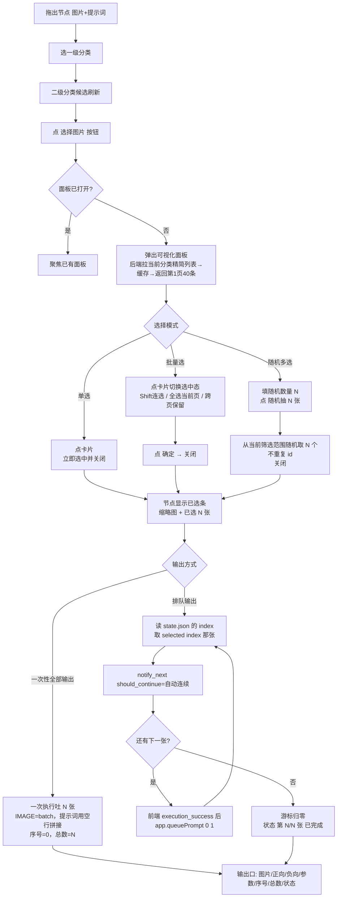

# PRD：dogking-tools 节点 v2（PromptVault 可视化选择）

- **Language**：中文
- **Programming Language**：Python（ComfyUI 后端）+ 原生 JS（ComfyUI 前端扩展，无框架）
- **Project Name**：`dogking_tools_nodes_v2`
- **原始需求**：

> 现在开始提comfyui节点的优化要求：这些通通没用删掉，下面是新节点
>
> **1：图片和提示词输出**
> 服务器地址默认填好，分类就读取软件的分类一级到二级，选好后下方弹出可视化选择，可以选取图片，可以上下翻页，都是读取软件的数据，在这个可视化界面里还有一些选项：单选，批量选，随机多选，批量和随机多选有一次性全部输出和排队输出两个方式，排队就是以前的持久化，输出出口必须有图片和提示词。
>
> **2：大改词库**
> 服务器默认填好，模式分：输出lora触发词，编辑指令，LLM系统提示词这三个栏位的数据，也是弹出可视化选择，做矩形卡片容器来选择，支持翻页。默认只能单选输出。
>
> **3：上传资产图节点**
> 这个节点直接读取资产图栏目，改自核心节点加载图片，不够直接对接选择的是软件的资产图栏目，单张加载，可以更改选择。
>
> **4：上传资产图节点（多重）**
> 3节点的批量输出版，可以多选输出，右边输出有 独立输出图片接口。

---

## 1. 背景与目标

### 1.1 背景

现有 4 个 PromptVault 节点（`DogkingPVPrompt` / `DogkingPVImage` / `DogkingPVPair` / `DogkingPVText`）是**"分类 + 模式 + 起止序号"的盲选式取数**：用户在节点上看不到图，只能按序号顺序一条条吐，想挑某几张必须自己算序号、或在 PromptVault 里先筛分类。实际使用中"选图"这个动作完全在 ComfyUI 外面完成，节点只是个搬运工。

用户要的是**在节点里看图挑图**：可视化面板 + 翻页 + 单选/多选/随机 + 一次性/排队两种消费方式，并把 PromptVault 的「资产图」栏目也接进来（角色参考图之类的素材，以前只能靠本地文件夹）。

### 1.2 产品目标

1. **选择前移到节点内**：选图/选词全部在 ComfyUI 画布内完成，不用回 PromptVault 里筛、不用记序号。
2. **一次挑选、两种消费**：同一份选中清单既能一次性全吐（batch），也能排队逐条跑（原持久化行为），不用建两套工作流。
3. **资产图进流水线**：PromptVault 资产图栏目可直接作为图源，替代"先导出到文件夹再读"的手工步骤。

### 1.3 数据源实测事实（架构约束，已实测确认）

本地 PromptVault 便携版 **1.3.10** 运行中，实测结论：

| 事实 | 结论 |
|---|---|
| 桥接口只有 6 个 | `GET /api/health`、`/api/ping`、`/api/categories`、`/api/items`、`/api/image`、`/api/text` |
| **没有资产图接口** | `/api/health` 报 `assets: 78`，但 `/api/items?type=assets`、`/api/assets` 全部返回 `不支持的 type` / `未知接口`。渲染层 `PV_API` 也只有 `getHealth/getCategories/getItems/getImageBase64/getText` |
| `/api/items` 一次返回全量 | 17726 张图 → **36 MB**，耗时 0.37s；`limit`/`offset`/`page`/`pageSize` 参数**被忽略**（返回体大小完全不变） |
| 按分类筛选仍然很大 | 一级「风格」`includeChildren=1` → 12042 张 / 24 MB；二级「写实摄影」→ 9328 张 / 19 MB |
| 分类数据模型 | 图片只暴露 `categoryId`（可能是二级 id），**不返回 `subCategoryId`**；一级分类不传 `includeChildren` 时返回 **0 张**（图都挂在二级下） |
| 缩略图可用 | `/api/image?id=…&size=thumb` → 约 35 KB JPEG；`size=full` → 原图 |
| `/api/items` 不排序 | 源码注释明确「排序交给调用方」，返回顺序 = 内存数组顺序 |
| 词库字段 | 统一成 `{id, name, text}`；**68 条 LORA 触发词里大量 `text` 是空字符串**（触发词未填） |
| 资产图数据模型 | `{id, name, category, project, note, blob, thumb, size, mime, width, height}`；**无 tags、无 id 型分类**，`category`/`project` 都是字符串名，是「分类 + 项目」两个维度 |

由此得到两条硬约束：

- **C1（阻塞项）**：节点 3 / 4 依赖 PromptVault 新增接口，否则无法实现。当前插件侧无任何绕行方案（数据在 Electron 渲染进程的 IndexedDB 里，磁盘上读不到）。
- **C2（性能）**：可视化面板的分页**必须在 ComfyUI 后端做**。后端一次拉全量后在内存里缓存精简列表（只留 `id/name/categoryId/width/height/createdAt`，17726 条约 1.5 MB），翻页只回当前页 40 条的元数据；前端**绝不能**一次拿 36 MB。

---

## 2. 变更范围

用户说「这些通通没用删掉」，指的是截图里那 4 个 PromptVault 节点。但新需求里节点 1 = 图片+提示词、节点 2 = 词库，正是旧 4 个节点里最常用的两个。

### 2.1 处置判断：**删掉旧 4 个、重建 4 个新的**（推荐）

| 节点 | 现状 | 处置 |
|---|---|---|
| `DogkingPVPrompt`（提示词：正向/负向/参数） | 分类 + 模式 + 起止序号盲选 | **删除**，能力并入新节点 1 |
| `DogkingPVImage`（图片） | 同上 | **删除**，能力并入新节点 1 |
| `DogkingPVPair`（图片+提示词） | 同上 | **删除**，由新节点 1 取代 |
| `DogkingPVText`（词库） | 分类 + 类型 + 序号盲选 | **删除**，由新节点 2 取代 |
| 新节点 1 图片+提示词 | — | **新增** `DogkingPVPick` |
| 新节点 2 词库 | — | **新增** `DogkingPVVault` |
| 新节点 3 资产图（单张） | — | **新增** `DogkingPVAsset` |
| 新节点 4 资产图（多重） | — | **新增** `DogkingPVAssets` |
| `nodes.py` 的「提示词批量加载 / 图片批量加载」 | 读本地 txt / 文件夹 | **不动** |
| `ripple_upscale.py` | — | **不动** |

**理由**：

1. 参数模型不兼容。旧节点是「分类 + 模式（全部/范围/编号）+ 起止序号 + 自动连续」，本质是"用过滤器描述一个集合，按游标取第 N 条"。新节点是"用户显式挑出一份 id 清单，再决定一次性吐还是排队吐"——`_iterate()` / `advance_state()` 那套「source 变了就归零」的游标语义已经不成立，留着只会让两套状态机互相污染 `state.json`。
2. 旧节点的「分类」是单级路径下拉（`一级/二级` 拼成一个字符串），新节点要一级 + 二级两个联动下拉，INPUT_TYPES 结构就不同，改造成本高于重写。
3. 旧节点 `IS_CHANGED` 恒返回 `NaN`（强制每次都执行），这个行为在新节点里要按输出方式区分（见 3.1.5），也是改动而非沿用。

**代价与缓解**：删掉节点类后，用户已有工作流里这 4 个节点会变成红色 missing node。两个选项（见待确认 Q6）：
- **A（推荐，本次做）**：直接删，工作流需重连。旧的 HTTP 层（`resolve_base` / `fetch_items` / `fetch_text` / 缓存 / 端口探测）**全部保留复用**，删除的只是 4 个 `NODE_CLASS_MAPPINGS` 注册项和 `_iterate` 的游标逻辑，代码不是白写。
- **B（P1 可选）**：把旧 4 个 class 保留注册，显示名加「（旧版）」并挂到 `dogking-tools/legacy` 分类，成本 ≈ 0（代码本来就在），老工作流不断。

### 2.2 复用 / 改造清单（给架构师）

| 现有资产 | 处置 |
|---|---|
| `resolve_base` / `_discover_base` / 端口探测 / 绕代理 opener | **原样复用**（这块很扎实：并发探测、失败快速失败、换端口重探） |
| `fetch_categories` / `build_category_paths` / `category_id_from_path` / 分类落盘缓存 | **复用**，两级下拉依赖它 |
| `fetch_items` / `fetch_text` / `fetch_image_bytes` / `tensor_from_bytes` | **复用**，加"分页切片"和"内存缓存全量"两层 |
| `_advance` / `advance_state` / `notify_next` / `status_text` | **改**：游标从「序号 → 范围」改为「选中清单 → index」 |
| `_iterate` | **废弃**，拆成 `pick_*` 系列（选择态）+ 取数逻辑 |
| `server.py` 的 `pv_categories` | 复用，新增 4 个分页/缩略图代理接口 |
| 前端 `PV_NODES` 分支 / `applyPvModeVisibility` / `refreshPvCategories` / `drawBadge` | **改**：模式显隐换成「选择模式 / 输出方式」显隐；新增浮动面板模块 |
| 自动连续链路（`notify_next` → `dogking-tools.next` → `execution_success` → `app.queuePrompt(0,1)`） | **原样复用**，这就是"排队输出"的现成管道 |

---

## 3. 四个节点的需求规格

### 通用约定（4 个节点共用）

**服务地址**：`STRING`，默认空串 = 自动发现 8765–8775。用户要求"默认填好"，实现上就是**不给用户填**：默认空串即自动，节点/面板顶部显示实际连上的地址（如 `已连接 127.0.0.1:8765`），连不上显示 `PromptVault 未连接`。**不写死端口**——写死 8765 反而会在端口漂移时失败（现有代码已踩过这个坑）。

**可视化面板（Overlay）通用规格**：

| 项 | 规格 |
|---|---|
| 形态 | **浮动覆盖层**（`position: fixed` 挂 `document.body`），不是嵌在节点里的 DOM widget |
| 理由 | 嵌在节点里会让节点变成 900×700 的巨物，且画布缩放/平移会破坏内部滚动和点击热区；overlay 不随画布变换，交互最稳 |
| 尺寸 | 宽 `min(1080px, 92vw)`，高 `min(680px, 86vh)`，居中偏上（top 6vh），圆角 12px，深色底 + 半透明遮罩 |
| 位置 | 屏幕居中，与节点位置无关（不跟随节点） |
| 关闭 | ① 右上角 `×` ② `Esc` ③ 点遮罩空白处 ④ 单选模式下选中即自动关 ⑤ 点「取消」 |
| 单例 | 全局同时只允许 1 个面板；已有面板打开时再点按钮 = 聚焦已有面板，不叠开 |
| 键盘 | `←`/`→` 翻页，`Esc` 关闭，`Enter` 确认（多选模式） |
| 加载态 | 首帧显示骨架格 + 「读取中…」；后端首次拉全量约 0.4s，之后翻页应 < 100ms（走缓存） |
| 缩略图 | 一律走 ComfyUI 后端代理 `/dogking-tools/pv_thumb`（浏览器直连 PromptVault 会被 CORS 拦），`loading="lazy"`，单张约 35 KB |
| 失败态 | 面板内显示错误文案 + 「重试」按钮，不弹 `alert` |

**状态条**：沿用现有 `ui.dogking_status` → 节点底部 `drawBadge` 徽标，格式见各节点。

---

### 3.1 节点 1：图片 + 提示词（`DogkingPVPick`）

#### 3.1.1 参数表

| 参数 | 类型 | 默认 | 说明 | 显隐 |
|---|---|---|---|---|
| 服务地址 | STRING | `""` | 空 = 自动发现；也可填 `127.0.0.1:8766` 强制指定 | 常显 |
| 一级分类 | COMBO（动态） | `全部` | PromptVault 一级分类名 + 「全部」 | 常显 |
| 二级分类 | COMBO（动态） | `全部` | 随一级联动；一级为「全部」时只有「全部」一项 | 常显 |
| 选择模式 | COMBO | `单选` | `单选` / `批量选` / `随机多选` | 常显 |
| 随机数量 | INT | `4`（min 1 / max 200） | 随机多选取几张 | 仅随机多选 |
| 输出方式 | COMBO | `排队输出` | `一次性全部输出` / `排队输出` | **仅批量选 / 随机多选**（单选时隐藏） |
| 自动连续 | BOOLEAN | `true` | 排队输出时是否自动排下一次队列 | 仅排队输出 |
| 已选清单 | STRING（隐藏） | `""` | JSON 数组，存图片 id 列表；序列化进工作流 | 隐藏 |
| *（按钮）* | button | — | **选择图片** | 常显 |
| *（按钮）* | button | — | **清空已选** | 有选中时显示 |
| *（按钮）* | button | — | **重置计数** | 排队输出时显示 |

> 二级分类的取值校验坑：ComfyUI 会用 INPUT_TYPES 的列表核对保存的工作流值。二级列表随一级变化，因此沿用现有做法——后端落盘缓存 + 前端动态刷 `options.values`，拉不到时**保留用户已选值不清空**（现有 `applyPvCategoryValues` 已实现，直接复用）。

#### 3.1.2 交互流程

1. 用户拖出节点 → 参数区显示「一级分类 = 全部」「二级分类 = 全部」「选择模式 = 单选」，底部状态条空，按钮区只有「选择图片」。
2. 选一级分类 → 二级分类的候选值刷新为该一级下的二级分类 + 「全部」。
3. 点「选择图片」→ **弹出可视化面板**（通用规格见上）。
4. 面板内浏览：网格显示当前「一级 + 二级 + 搜索词」范围内的图，每页 **40 张**（8 列 × 5 行），每格 96×96 缩略图 + 底部单行名称（超长省略）。
5. 按选择模式交互（见 3.1.3）。
6. 确定 → 面板关闭 → 节点上出现**已选条**：`已选 12 张 · 第 1 张缩略图`，缩略图点击可重开面板。
7. 执行时按输出方式吐数据（见 3.1.5）。

**面板布局**：

```
┌────────────────────────────────────────────────────────────┐
│ 风格 / 写实摄影 ▾    [搜索框________]  共 9328 张      ×  │  ← 工具条（高 52）
├────────────────────────────────────────────────────────────┤
│  ┌────┐ ┌────┐ ┌────┐ ┌────┐ ┌────┐ ┌────┐ ┌────┐ ┌────┐ │
│  │img │ │img │ │img │ │img │ │img │ │img │ │img │ │img │ │  ← 网格 8 列 × 5 行
│  └────┘ └────┘ └────┘ └────┘ └────┘ └────┘ └────┘ └────┘ │     （每页 40 张）
│   …（5 行，共 40 格）                                      │
├────────────────────────────────────────────────────────────┤
│ « 首页  ‹ 上一页   第 3 / 234 页   下一页 ›  末页 »        │  ← 分页器（高 56）
│ 每页 20/40/80▾        已选 12 张  清空  取消  确定         │
└────────────────────────────────────────────────────────────┘
```

- **分页**：每页 40 张（可选 20/40/80）。翻页只重新拉当前页元数据，缩略图按需加载。
- **搜索**：输入框 300ms 防抖，调后端在内存缓存里做 `name / positive / tags` 包含匹配（与 PromptVault 自身语义一致）。
- **翻页越界**：首页/上一页在第 1 页时置灰，末页同理。

#### 3.1.3 三种选择模式

| 模式 | 点卡片的行为 | 多选方式 | 确定后 |
|---|---|---|---|
| **单选** | 点卡片 = 立刻选中，**面板立即关闭**（1 次点击完成全流程） | 不可多选 | 已选清单 = 1 个 id |
| **批量选** | 点卡片 = 切换该卡选中态（蓝色 2px 描边 + 右上角勾选角标） | ① 逐张点选 ② `Shift + 点击` 连选当前页区间 ③ 底部「全选当前页 / 清空」 ④ 跨页保留（按 id 存，不按页存） | 已选清单 = N 个 id，按点选顺序 |
| **随机多选** | 卡片不参与点选，改为工具条右侧出现「随机数量」输入 + 「随机抽 N 张」按钮 | 点按钮 → 从**当前筛选范围**（一级+二级+搜索）里随机取 N 个**不重复** id | 已选清单 = N 个 id（随机顺序）；点「确定」后关闭 |

- 选中计数实时显示在底部（`已选 12 张`），超过 1 张时显示「清空」。
- 已选清单里若含**当前筛选范围外**的图（用户改了分类），保留不清空——它是显式清单，跟筛选范围无关。
- 执行时若某 id 在 PromptVault 里已不存在 → 跳过该条，状态条写 `第 3/12 张（2 张已失效，已跳过）`，不抛异常（沿用现有"跳过并说明原因"的策略，否则批量队列会断）。

#### 3.1.4 已选条（节点上的常驻显示）

面板关闭后节点上显示一行 DOM widget（高 64px）：

```
[缩略图 48×48]  已选 12 张 · 风格/写实摄影 · 点击重新选择
```

- 点缩略图或整行 → 重开面板，且**保留已选状态**（已选卡片带角标）。
- 无选中时显示灰字 `未选择 · 点击「选择图片」`。

#### 3.1.5 输出方式（与选择模式的组合）

| 选择模式 | 输出方式 | 行为 |
|---|---|---|
| 单选 | **无此参数（隐藏）** | 固定等价于「一次性全部输出」，即 1 张。用户只选 1 张时"排队"没有意义（清单里没有下一张），所以隐藏而不是给个无效选项 |
| 批量选 | 一次性全部输出 | 一次执行吐 N 张：`IMAGE` 输出 batch tensor `[N,H,W,3]`；`正向/负向/参数` 按 `\n\n` 拼接成一个字符串 |
| 批量选 | 排队输出 | 一次执行吐第 1 张，`notify_next(should_continue=自动连续)` 自动排下一次队列，逐张推进，直到 N 张跑完；跑完游标归零（下次执行重新从第 1 张开始） |
| 随机多选 | 一次性全部输出 | 同批量一次性 |
| 随机多选 | 排队输出 | 同批量排队（清单顺序 = 随机顺序） |

**一次性输出的两个必须明确的细节**（待确认 Q2、Q3）：

- **尺寸统一**：多张图尺寸不同，batch 要求同尺寸。**默认策略：以第 1 张的宽高为基准，其余 bilinear 缩放到该尺寸**（等比拉伸，不裁切——裁切会改变构图，破坏"用这张图当参考"的语义）。
- **提示词拼接**：`正向` 用 `\n\n` 连接；`负向` 用 `\n\n` 连接；`参数` 用 `\n` 连接。分隔符 P2 可配。
- **显存提示**：N > 8 时节点底部显示黄色提示 `一次输出 12 张，注意显存`（不阻断）。

**游标状态**（`state.json`）：

```json
"<node_id>": {
  "kind": "pv2",
  "source": "<addr>|<一级id>|<二级id>|<搜索词>",
  "selected": ["mvz14udf-mo0ien", "..."],
  "index": 3
}
```

- 新 `kind: "pv2"`，与旧的 `"pv"` / `"image"` 完全隔离，不会互相污染。
- `source` 变化（换分类/换地址/搜索词变）→ `index` 归零，但 `selected` 保留（清单是用户显式选的，不该被筛选条件清掉）。
- `selected` 与 `已选清单` widget 内容不一致时，以 widget 为准（用户手改/换工作流后以序列化的为准）。

#### 3.1.6 输出口

| # | 名称 | 类型 | 说明 |
|---|---|---|---|
| 1 | 图片 | IMAGE | 单张 `[1,H,W,3]`；一次性模式为 batch `[N,H,W,3]` |
| 2 | 正向 | STRING | 一次性模式为 `\n\n` 拼接 |
| 3 | 负向 | STRING | 同上 |
| 4 | 参数 | STRING | 同上 |
| 5 | 当前序号 | INT | 排队模式为 1..N；一次性模式为 0 |
| 6 | 总数 | INT | 已选清单长度 |
| 7 | 状态 | STRING | 见下 |

状态条文案：
- 排队：`第 3/12 张（排队输出 · 风格/写实摄影）`
- 一次性：`已输出 12 张（一次性 · 风格/写实摄影）`
- 空：`未选择图片` / `该分类下没有图片` / `PromptVault 未运行（试过 8765-8775），请先打开 PromptVault`

`IS_CHANGED`：排队模式返回 `NaN`（强制每次执行）；一次性模式也返回 `NaN`（同一张图重跑需要重新下载，且用户可能改了清单）。

---

### 3.2 节点 2：词库（`DogkingPVVault`）

#### 3.2.1 参数表

| 参数 | 类型 | 默认 | 说明 | 显隐 |
|---|---|---|---|---|
| 服务地址 | STRING | `""` | 同节点 1 | 常显 |
| 数据源 | COMBO | `LORA触发词` | `LORA触发词` / `编辑指令` / `LLM系统提示词`（对应 `/api/text?type=loras|edits|system-prompts`） | 常显 |
| 多选 | BOOLEAN | `false` | 默认关 = 只能单选输出 | 常显 |
| 已选清单 | STRING（隐藏） | `""` | JSON 数组，存 `{id, name}` | 隐藏 |
| *（按钮）* | button | — | **选择词条** | 常显 |
| *（按钮）* | button | — | **清空已选** | 有选中时显示 |

> 旧节点那个共用的「分类」参数在这里**彻底移除**（词库本身没有分类概念，旧代码靠 `text_type` 分支忽略它，属于历史包袱）。

#### 3.2.2 面板：矩形卡片容器

不是图片网格，是**卡片列表**：

```
┌────────────────────────────────────────────────────────────┐
│ LORA触发词   [搜索框______]  共 68 条                  ×   │
├────────────────────────────────────────────────────────────┤
│ ┌──────────────────────┐ ┌──────────────────────┐          │
│ │ 姬紫月K2-jiziyue     │ │ h3_character_swap    │          │  ← 卡片 320×110
│ │ ─────────────────    │ │ ─────────────────    │          │     3 列 × 4 行
│ │ （无触发词）         │ │ 触发词内容摘要…      │          │     = 每页 12 张
│ │                 0 字 │ │               42 字  │          │
│ └──────────────────────┘ └──────────────────────┘          │
│  …（4 行，共 12 张）                                       │
├────────────────────────────────────────────────────────────┤
│ « 首页  ‹ 上一页   第 2 / 6 页   下一页 ›  末页 »          │
│ 每页 12/24/48▾        已选 1 条  清空  取消  确定          │
└────────────────────────────────────────────────────────────┘
```

**卡片内容**：

| 区域 | 内容 |
|---|---|
| 标题行 | `name`（LORA = 文件名；编辑指令/系统提示词 = 标题），1 行省略，hover 显示全名 tooltip |
| 分隔线 | 1px |
| 正文 | `text` 前 3 行，末尾 `…`；**空内容显示灰字「（无触发词）」/「（空）」** |
| 右下角 | 字符数 `42 字`（帮用户判断是短触发词还是长指令） |
| 选中态 | 蓝色 2px 描边 + 左上角勾选角标 |

- 每页 **12 张**（3 列 × 4 行），可选 12/24/48。分页/搜索/关闭/单例规则同通用规格。
- 点击卡片弹出**详情浮层**（P2）：显示完整 text + 「复制」按钮。P0 只做 tooltip。

#### 3.2.3 选择与输出

- **默认单选**：点卡片 = 选中并立即关闭面板，输出 1 条。
- **打开「多选」开关**：卡片可切换选中态 + `Shift` 连选 + 全选当前页；确定后输出多条，`内容` 按 `\n\n` 拼接、`名称` 按 `, ` 拼接。
- **空触发词的处理**（实测 68 条 loras 大量为空）：卡片显式标注「（无触发词）」，仍然可选（用户可能只是想拿文件名）。P1 加「隐藏空内容」筛选勾选。

#### 3.2.4 输出口

| # | 名称 | 类型 | 说明 |
|---|---|---|---|
| 1 | 内容 | STRING | `text`；多选时 `\n\n` 拼接 |
| 2 | 名称 | STRING | `name`；多选时 `, ` 拼接 |
| 3 | 当前序号 | INT | 单选固定 1；多选固定 0 |
| 4 | 总数 | INT | 已选条数 |
| 5 | 状态 | STRING | `已选 1 条（LORA触发词）` / `该类型下没有内容` |

> 词库节点没有"排队输出"（用户明确"默认只能单选输出"）。如果后续要排队，复用节点 1 的游标机制即可，本次不做。

---

### 3.3 节点 3：上传资产图（单张）（`DogkingPVAsset`）

#### 3.3.1 前置依赖（阻塞）

**当前 PromptVault 1.3.10 没有资产图接口**（见 1.3）。本节点必须等 PromptVault 侧补：

- `GET /api/assets?category=<名>&project=<名>` → `{ok, total, items: [{id, name, category, project, note, size, mime, width, height, createdAt}]}`（不含 blob）
- `GET /api/asset-image?id=<id>&size=thumb|full` → 二进制

若 PromptVault 侧短期无法提供，本节点与节点 4 **无法交付**（数据在渲染进程 IndexedDB，插件读不到磁盘文件）。这是本项目最大的单点风险，需用户先确认 PromptVault 是否可改。

#### 3.3.2 参数表

| 参数 | 类型 | 默认 | 说明 |
|---|---|---|---|
| 服务地址 | STRING | `""` | 同节点 1 |
| 资产分类 | COMBO（动态） | `全部` | 资产图栏目的「分类」维度（字符串名）+「全部」 |
| 项目 | COMBO（动态） | `全部` | 资产图栏目的「项目」维度（字符串名）+「全部」+「未分项目」 |
| 已选资产 | STRING（隐藏） | `""` | JSON `{id, name}` |
| *（按钮）* | button | — | **选择资产图** |

> 资产图**没有一级/二级分类**，只有 `category`（分类名）和 `project`（项目名）两个平级字符串维度——这点和图片不同，面板里做成两个下拉而非两级联动。

#### 3.3.3 交互流程

1. 节点创建 → 参数区三个项 + 「选择资产图」按钮。
2. 点按钮 → 弹出**同一个图片网格面板**（复用节点 1 的面板组件，只是数据源换成 `/api/assets`）。
3. **单选**：点卡片 = 选中 + 立即关闭。
4. 节点上显示**预览块**（DOM widget，高 180px）：居中显示选中资产图的缩略图（保持比例，最大 160×160）+ 下方名称 + `512×768 · 84 KB`。
5. 未选择时预览块显示 `未选择 · 点击「选择资产图」`。
6. **更改选择**：再点按钮重开面板，已选卡片带角标；也可点预览块本身重开（同节点 1）。
7. 执行：按 id 拉 `size=full` → 解码成 tensor。

#### 3.3.4 输出口

| # | 名称 | 类型 | 说明 |
|---|---|---|---|
| 1 | 图片 | IMAGE | `[1,H,W,3]` float32，0–1 |
| 2 | 名称 | STRING | 资产图 name |
| 3 | 状态 | STRING | `已加载「角色四视图-正面」` / `未选择资产图` / 接口错误 |

失败策略沿用现有：下载/解码失败返回 64×64 灰图 + 状态里写原因，不抛异常。

---

### 3.4 节点 4：上传资产图（多重）（`DogkingPVAssets`）

#### 3.4.1 参数表

| 参数 | 类型 | 默认 | 说明 |
|---|---|---|---|
| 服务地址 | STRING | `""` | 同上 |
| 资产分类 | COMBO（动态） | `全部` | 同上 |
| 项目 | COMBO（动态） | `全部` | 同上 |
| 输出方式 | COMBO | `独立输出` | `独立输出`（每张一个口）/ `批量输出`（一个 batch 口） |
| 已选资产 | STRING（隐藏） | `""` | JSON 数组 `[{id,name}]`，序列化进工作流 |
| *（按钮）* | button | — | **选择资产图（多选）** |
| *（按钮）* | button | — | **清空已选** |

#### 3.4.2 交互

- 面板 = 节点 3 的面板 + **强制多选**（点选切换 + `Shift` 连选 + 全选当前页 + 跨页保留），底部显示 `已选 4 张`。
- 确定后节点上显示缩略图条：4 个 48×48 缩略图横排（超出换行），每张右上角 `×` 可单独移除。
- 排序 = 点选顺序（决定输出口顺序，用户可预期）。

#### 3.4.3 「右边输出有独立输出图片接口」——我的解读

**理解为：每张选中的图在节点右侧各占一个独立的 IMAGE 输出口，口的数量随选中张数动态增减。**

理由：
- 「独立」二字是关键。如果只是一个 batch 口，那就是"一个口吐多张"，用户不会说"独立输出图片接口"。
- 多重资产图的典型用法是**一张图接一个下游分支**（正面图 → VAE Encode A，侧面图 → ControlNet B，背面图 → IPAdapter C）。batch 口做不到，必须拆成多个口。
- 用户说的"右边"也印证了是**输出侧多个口**，不是"另外再给一个 batch 口"。

**实现约束（必须让架构师知道）**：ComfyUI 的 `RETURN_TYPES` 是类级静态定义，动态增减输出口需要前端 hack：

- 后端按**固定上限 8 个**声明 `RETURN_TYPES = ("IMAGE",) * 8 + ("STRING", "INT", "STRING")`，`RETURN_NAMES = ("图1".."图8", "名称", "总数", "状态")`，返回 tuple 长度固定 11，未用的口填 `None`（下游不会执行，因为没连线）。
- 前端在 `onConfigure` / 面板确定后，用 `node.addOutput()` / `removeOutput()` 把可见口数量对齐到 `min(选中数, 8)`，并 `setSize` 重排。
- 选中数 > 8 时：状态条提示 `已选 12 张，仅前 8 张有独立输出口`，其余只能走「批量输出」模式。

**备选方案（B，更简单但语义弱）**：一个 IMAGE 输出口吐 batch `[N,H,W,3]` + 一个 `名称` 口。若用户其实想要 batch，方案 B 更省事。→ 见待确认 Q1。

#### 3.4.4 输出口

**方案 A（推荐，独立输出）**：

| # | 名称 | 类型 | 说明 |
|---|---|---|---|
| 1–8 | 图1 … 图8 | IMAGE | 每张一个独立口，未用的返回 `None` |
| 9 | 名称 | STRING | `, ` 拼接全部选中名称 |
| 10 | 总数 | INT | 选中张数 |
| 11 | 状态 | STRING | `已输出 4 张（独立输出）` |

**方案 B（批量输出）**：

| # | 名称 | 类型 | 说明 |
|---|---|---|---|
| 1 | 图片 | IMAGE | batch `[N,H,W,3]`，尺寸统一策略同 3.1.5（以第 1 张为基准 resize） |
| 2 | 名称 | STRING | `, ` 拼接 |
| 3 | 总数 | INT | |
| 4 | 状态 | STRING | |

---

## 4. 交互流程图（节点 1）



---

## 5. 需求池

### P0（必须，否则功能不成立）

| # | 需求 | 节点 | 备注 |
|---|---|---|---|
| P0-1 | 后端分页代理接口（`pv_page` / `pv_text_page` / `pv_thumb`），全量列表内存缓存 + 精简字段 | 1/2 | 36 MB 全量绝不能进浏览器 |
| P0-2 | 浮动面板组件（网格 + 卡片两种视图，单例，Esc/遮罩/× 关闭） | 1/2/3/4 | 一个组件两套渲染 |
| P0-3 | 两级分类联动下拉（一级 → 二级），落盘兜底不丢已选值 | 1 | 二级筛选必须把二级 id 传给 `/api/items`，**不能自己按 `categoryId` 比对**（接口不返回 `subCategoryId`） |
| P0-4 | 单选 / 批量选 / 随机多选 三种选择模式 | 1 | 选中态、Shift 连选、跨页保留 |
| P0-5 | 一次性全部输出 + 排队输出（复用 `notify_next` 管道） | 1 | 单选时隐藏输出方式 |
| P0-6 | 显式选中清单序列化进工作流（隐藏 widget） | 1/2/3/4 | 换机/重开不丢 |
| P0-7 | `state.json` 新 `kind: "pv2"`，`selected` + `index`，与旧记录隔离 | 1 | 避免污染旧节点进度 |
| P0-8 | 词库卡片面板（标题 + 摘要 + 字数），默认单选 | 2 | 空内容显式标注 |
| P0-9 | 资产图接口对接（分类 + 项目两维度）+ 单张加载 + 预览块 | 3 | **依赖 PromptVault 新增接口（阻塞）** |
| P0-10 | 资产图多选 + 独立输出口（≤8 动态口） | 4 | **依赖 PromptVault 新增接口（阻塞）** |
| P0-11 | 删除旧 4 个节点注册，新 4 个节点注册 | 全部 | 见 Q6 |

### P1（应该）

| # | 需求 | 节点 |
|---|---|---|
| P1-1 | 面板内搜索（300ms 防抖，name/positive/tags 包含匹配） | 1/2 |
| P1-2 | 词库「多选」开关 | 2 |
| P1-3 | 每页张数切换（20/40/80、12/24/48） | 1/2 |
| P1-4 | 已选清单失效 id 跳过 + 状态提示 | 1/3/4 |
| P1-5 | 资产图多选缩略图条 + 单张移除 | 4 |
| P1-6 | 旧 4 个节点保留为「旧版」分类（兼容老工作流） | — |
| P1-7 | 词库「隐藏空内容」筛选 | 2 |

### P2（可选）

| # | 需求 | 节点 |
|---|---|---|
| P2-1 | 一次性输出的尺寸统一策略可配（resize/pad/crop）与分隔符可配 | 1/4 |
| P2-2 | 随机选择的固定种子（可复现） | 1 |
| P2-3 | 词库卡片点击弹出全文详情 + 复制 | 2 |
| P2-4 | 面板内按创建时间/名称排序切换 | 1/3/4 |
| P2-5 | 资产图独立输出口上限可配（默认 8） | 4 |
| P2-6 | 缩略图本地磁盘缓存（减少重复请求） | 1/3/4 |

---

## 6. 待确认问题

| # | 问题 | 我的倾向 |
|---|---|---|
| **Q1** | **节点 4 的「右边输出有独立输出图片接口」到底指什么？** 我理解为「每张选中图各占一个独立 IMAGE 输出口，口数随选中张数动态增减（上限 8）」。如果你的意思是「一个口吐 batch」或「独立口 + 额外一个 batch 口」，请指出 | 独立口（上限 8）+ 参数里保留「批量输出」作为可切换模式 |
| **Q2** | **一次性全部输出多张图时，尺寸不同怎么统一？** 必须统一成同尺寸才能拼 batch | 以第 1 张宽高为基准，其余等比拉伸 resize（不裁切） |
| **Q3** | 一次性输出时**提示词怎么给**？拼成一个长字符串（下游 CLIP 会一起编码，可能互相干扰），还是只输出第 1 张的？ | `\n\n` 拼接全部 |
| **Q4** | **单选模式下那两个输出方式怎么处理？** 我的判断：单选时「输出方式」参数直接隐藏，固定一次性（清单只有 1 张，排队没有意义） | 隐藏 |
| **Q5** | **随机多选要几张？** 做成参数（默认 4，1–200）还是固定？另外"不重复"是必须的吧 | 参数化，不重复 |
| **Q6** | **删掉旧 4 个节点后，现有工作流会断（节点变红）**，要不要兼容？ | 直接删（代码里的 HTTP 层全保留复用）；如你不想断，把旧 4 个保留成「旧版」分类，成本几乎为零 |
| **Q7** | **可视化面板是弹窗覆盖还是嵌在节点里？** 我选弹窗覆盖（1080×680，居中，Esc/遮罩/× 关闭），因为嵌在节点里会让节点变成巨物且缩放会毁掉交互 | 弹窗覆盖 |
| **Q8** | **资产图接口必须由 PromptVault 侧新增**（现在 1.3.10 完全没有：`/api/assets`、`/api/asset-image` 都返回未知接口）。这个能不能改？改不了的话节点 3/4 无法交付 | 需你确认 PromptVault 是否可改；可改则优先加 `/api/assets` + `/api/asset-image` |
| **Q9** | 资产图有「分类」和「项目」两个维度（字符串名，不是 id）。节点上要两个下拉都暴露，还是只留「分类」？ | 两个都暴露，默认「全部」 |
| **Q10** | 词库里 68 条 LORA 触发词**大量 `text` 是空字符串**（触发词没填）。空触发词要不要在面板里默认隐藏？ | 显式标注「（无触发词）」，不隐藏（P1 加筛选开关） |
| **Q11** | 排队输出跑完 N 张后，**游标归零重头开始**，还是停下等手动重置？（现有行为是归零，即下一轮又从第 1 张开始） | 归零（沿用现有） |
| **Q12** | 面板每页张数：图片 40、词库 12，够用吗？还是想更大/更小 | 图片 40（8×5）、词库 12（3×4） |
